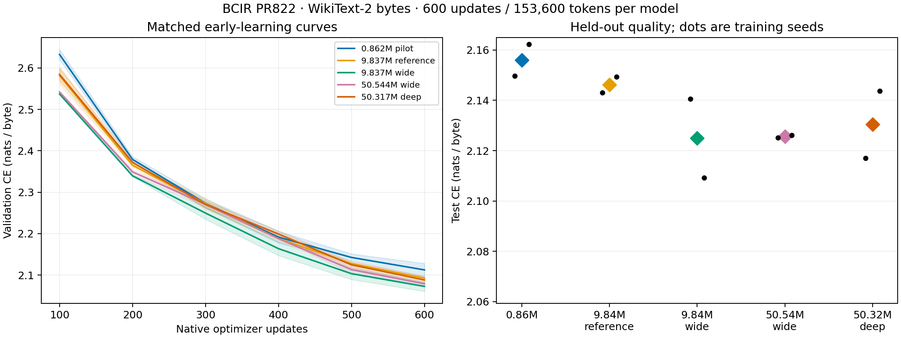

# BCIR: 50M training, architecture selection and weight-space programming

Study initiated 4 November 2026 · Report generated 05 November 2026 00:21 UTC · CPU experiments on merged PR #822

**The container is updated to `80e9507531b7597ef81d0348db75f0fd5dcd8134`, the merge of PR #822. Native training at roughly 50 million parameters succeeds.** This study completed **10 training runs, 6,000 quality-training updates and 1,536,000 supervised byte targets** across five recipes and two seeds. All completed runs have the same 600-update / 153,600-token budget. Timing warmups, dispatch calibration and edit-reference updates are separate.

The validation-selected 50M candidate is **50.544M wide**, with **50,544,384 parameters**. Its mean held-out byte cross-entropy is **2.12566 nats**, versus **2.14622** for the re-trained 9.837M reference and **2.12490** for the wider 9.837M recipe. These are new matched short-budget comparisons, not a reproduction of the older 1,000-update, B8/T128 report or its corpus/hardware numbers. This budget is far too small to establish a converged or compute-optimal 50M language model.

The wider 9.837M recipe is the economical choice for this observed short-budget quality level: it has essentially the same mean test loss and much smaller planned storage. The 50M recipe requires **4.75× its observed native training time**. Two seeds do not establish statistical equivalence. The 50M recommendation is a scale candidate for further data exposure, not a demonstrated improvement over that compact recipe.

**Weight programming has a concrete but bounded role.** A hand-programmed neural arithmetic circuit passes an exhaustive domain check. A weight-only norm repair corrects a deliberately injected outlier in trained 10M and 50M models, with maximum remaining CE difference from the clean reference **0.000001 nats**. Clean-model rank-one proposals improve test CE in **0 of 4** cases; detailed directions, no-op selections and controls are below. Those results must be read separately from fault repair. None of these tests establishes that an LLM can inspect arbitrary model weights and replace pretraining.

## 1. What the latest BCIR evidence supports

| Retained study | Finding relevant to this decision | Consequence for the new design |
| --- | --- | --- |
| [gp-global](https://github.com/Mecca-Research/Binary-Correspondence-Intermediate-Representation/blob/80e9507531b7597ef81d0348db75f0fd5dcd8134/docs/research/gp-global/REPORT.md) | Global oriented wedge learned the simple recall task, but language CE 2.4568 exceeded attention's 2.1628. Removing global RoPE improved recall length extrapolation. | Preserve attention for language/binding; do not infer general memory quality from first-value recall. |
| [wedge-next](https://github.com/Mecca-Research/Binary-Correspondence-Intermediate-Representation/blob/80e9507531b7597ef81d0348db75f0fd5dcd8134/docs/research/wedge-next/BCIR_Global_Wedge_Advancement_Report_2026-10-17.md) | Reconstruction reduced the same model's arena from 30.875 to 10.703 MiB at additional compute cost. Variable-length training helped recall; a local/global blend improved language loss. | Optimize time to a quality target under memory constraints, rather than minimizing arena size alone. |
| [wedge-integrated](https://github.com/Mecca-Research/Binary-Correspondence-Intermediate-Representation/blob/80e9507531b7597ef81d0348db75f0fd5dcd8134/docs/research/wedge-integrated/BCIR_Global_Integrated_Recipe_Report_2026-10-18.md) | Reusable workspace, admitted budget tiers and removal of causally unused suffixes are implemented. Controlled native buffers are distinct from RSS. | Keep shape, numerical family, layout, optimizer state and physical execution explicit. |
| [wedge-query-aware](https://github.com/Mecca-Research/Binary-Correspondence-Intermediate-Representation/blob/80e9507531b7597ef81d0348db75f0fd5dcd8134/docs/research/wedge-query-aware/BCIR_Query_Aware_Head_Report_2026-10-18.md) | Query contraction improved ordered recall, but single/four-pair association stayed near chance; attention learned single-pair retrieval. | A stronger readout cannot be assumed to recover bindings discarded by the write-side representation. |
| [wedge-pr818](https://github.com/Mecca-Research/Binary-Correspondence-Intermediate-Representation/blob/80e9507531b7597ef81d0348db75f0fd5dcd8134/docs/research/wedge-pr818/BCIR_PR818_Geometric_Head_Report_2026-10-18.md) | The recorded 51 FP32 runs replayed exactly; BF16's cost depends on AMX availability and packing. | Keep FP32 as the new AMD-host control; do not transfer Intel-AMX throughput claims. |
| [PR822 geometric-head review](https://github.com/Mecca-Research/Binary-Correspondence-Intermediate-Representation/blob/80e9507531b7597ef81d0348db75f0fd5dcd8134/docs/research/BCIR_GEOMETRIC_HEAD_REVIEW_2026-10-19.md) | Later sections correct silent Inductor fallback, distinguish core clock from TSC, and measure attention, GEMM workspace, scheduling and inference changes. | Use current C sources and local timings. Earlier eager-fallback figures are not compiled-framework baselines. |

The geometric heads remain isolated research overlays in those reports; this study does not silently turn them into registered production operators. Scaling the current production attention trainer avoids changing architecture, runtime ABI and unregistered geometric kernels simultaneously. A later dual-channel experiment should keep local/binding capacity, full global rank, the conditioning guard and matched budgets, with a separate write-side binding ablation.

## 2. Container and numerical execution

| Item | Recorded configuration |
| --- | --- |
| Source | PR822 merged 29 October; main `80e9507531b7597ef81d0348db75f0fd5dcd8134` |
| CPU / quota | AMD EPYC 9V74; 8-CPU cgroup quota; 9 logical CPUs in affinity |
| Experiment concurrency | Two native pool threads; heavy stages serialized; NumPy BLAS limited to one thread |
| RAM / admission | 8 GiB cgroup limit; native model allocation admitted under a 4 GiB buffer budget |
| Training | Freshly built native BCIR C forward/backward/loss/AdamW; no framework fallback |
| Numerical family | `kblock+reduce+attn`: explicitly fused blocked GEMMs, fixed-chunk clipping reduction and fused attention products; FP32 persistent arrays |
| Build | GCC 13.3, C11, `-O3 -ffp-contract=off -fno-math-errno`, production `NativeDecoder.build` |
| Python packages | Python 3.12.14; NumPy 2.3.5; PyArrow 26.0.1; Matplotlib 3.10.8 |
| Device scope | CPU only; no exposed NVIDIA GPU; no GPU/SYCL/AMX/native-ARM measurement |

The source worktree is clean at the pinned merge. Six temporary checkpoint files created during checkout were preserved outside the worktree. Old retained shared objects were not executed. `results/build.json` hashes the newly built C library and four trainer/tensor source files. `results/host.json` records the actual environment. Full repository CI, latest LLVM/MLIR 23, Python 3.15 and Windows/ARM qualification were not rerun for this isolated study.

A runtime interruption ended the original execution session after the wider 50M seed-0 run had saved its 600-update state. No remaining training process was active. Completed results were reused; the unstarted second wide-50M seed was run after resumption on the same recorded CPU class, quota and memory limit. `results/runtime-interruption.json` records this event. Timing means spanning the interruption are especially descriptive, rather than controlled host-speed comparisons.

## 3. Architectures, training and selection

All recipes use causal GQA, RoPE, pre-RMSNorm, SwiGLU, tied 260-token embeddings and ordinary dense trainable weights. FF widths and channel sizes suit existing blocked kernels. Parameter counts come from the native/Python layout agreement; no dummy parameter padding is used. Recipes jointly vary width, depth, FF width and KV sharing. The study compares those complete recipes and cannot attribute a difference to one factor alone.

| Recipe | Parameters | Layers | Width | Q heads | KV heads | FF width | Native buffers MiB |
| --- | --- | --- | --- | --- | --- | --- | --- |
| 0.862M pilot | 861,888 | 2 | 192 | 4 | 2 | 512 | 22.80 |
| 9.837M reference | 9,836,928 | 6 | 384 | 8 | 4 | 1024 | 193.37 |
| 9.837M wide | 9,837,056 | 4 | 512 | 8 | 2 | 1152 | 186.25 |
| 50.544M wide | 50,544,384 | 8 | 768 | 12 | 4 | 2048 | 877.52 |
| 50.317M deep | 50,317,440 | 12 | 640 | 10 | 2 | 1664 | 891.81 |

Data are the retained WikiText-2 raw train/validation/test parquets, joined by newlines and UTF-8 byte encoded. Their source and encoded hashes are in `results/data.json`. Input IDs are 0–255; the vocabulary follows the earlier 260-token setup. Every model receives the same deterministic training batches per seed. Seeds are 20261104 and 20261105. The held-out test has 16,384 target bytes per trained checkpoint, sampled using seed 681104; it is a new sample of the same standard split, not a new corpus.

Each run uses B4/T64, 600 AdamW updates, peak LR 0.0006, 30-update warmup, cosine decay to 0.00006, betas 0.9/0.95, epsilon 1e-8, weight decay 0.1 and gradient clipping 1.0. Validation at each 100 updates selects the lowest-CE checkpoint. All test choices and edit rules were fixed before the first test execution. Model code/data hashes are in `protocol.json`; the separate weight and execution studies have their own protocols.

The initial 200-update 50M screen differed by just 0.01159 nats and about 1.4% mean time. `extension-protocol.json` was frozen before either wide-50M extension result or any test result. It completes both candidates on both seeds, then chooses lower mean validation CE. The original tie-break implementation used mean training time where its prose said median; the independent median benchmark gave the same initial choice. The extension removes that tie-break from the final choice. This remains exploratory architecture selection, with two seeds and one corpus.

### Fresh held-out results

| Recipe | Test CE by seed, nats ↓ | Mean CE ↓ | Byte accuracy ↑ | Mean native train s | Observed tokens/s |
| --- | --- | --- | --- | --- | --- |
| 0.862M pilot | 2.14973, 2.16239 | 2.15606 | 38.58% | 9.1 | 16803 |
| 9.837M reference | 2.14309, 2.14935 | 2.14622 | 38.56% | 78.7 | 1951 |
| 9.837M wide | 2.14053, 2.10927 | 2.12490 | 39.06% | 73.5 | 2091 |
| 50.544M wide | 2.12517, 2.12615 | 2.12566 | 39.08% | 349.3 | 440 |
| 50.317M deep | 2.11708, 2.14379 | 2.13044 | 39.00% | 368.8 | 417 |

Times include the native training calls and input/event wrapper work; exclude model initialization, validation, checkpointing, calibration and weight-edit evaluation. The study accumulated **1758.8 seconds** in quality-training calls. Runs were ordered, rather than interleaved timing trials, so throughput differences are descriptive. Planned buffers are not RSS; process peak RSS is cumulative within each process. `results/test-baselines.json` retains all per-seed metrics.

First *checked* validation CE ≤2.2, shown as update / native training seconds:

| Recipe | Seed 20261104 | Seed 20261105 |
| --- | --- | --- |
| 0.862M pilot | 400 / 6.5s | 500 / 7.8s |
| 9.837M reference | 400 / 53.5s | 400 / 51.9s |
| 9.837M wide | 400 / 49.5s | 400 / 47.6s |
| 50.544M wide | 400 / 233.0s | 400 / 234.6s |
| 50.317M deep | 400 / 248.3s | 500 / 300.1s |

Crossings are checked every 100 updates, not interpolated or certified sustained thresholds. The selected model has only **0.00304 training tokens per parameter**. Quality-versus-scale conclusions at this exposure are early-learning observations. They cannot establish scaling laws, long-context capability, instruction following or a substitute for a much larger data budget.

## 4. PR822 launch selection at the new scale

A separate fresh build enables the native per-job clock. Eight rotated rounds measure alternatives for `dispatch:down.fwd`, using the host-admitted ISA instances and worker counts. The choice table accepts only alternatives whose interval resolves below the default. This is one bounded family, not exhaustive kernel tuning. No timing table changes quality checkpoints.

| Recipe | Instance-family masks | Selected dispatch | Fixed/program state exact | Program words |
| --- | --- | --- | --- | --- |
| 9.837M reference | {'gemm': 7, 'attention': 7} | {} | True | 10800 |
| 50.544M wide | {'gemm': 7, 'attention': 7} | {} | True | 14160 |

From the same restored weights, moments, counter and beta powers, one fixed C training step and one selected launch-program step produce identical event values and SHA-256 hashes of weights, gradients and both moments. This checks the direct launch-program route at 50M. It does not qualify the whole GEM+/MLIR pack/planner path or establish a whole-model speedup from one family. Raw rounds and the integer choice tables are retained.

At the selected 50M scale, **11 additional finite-difference probes** span embeddings, every parameter role of a middle layer and the final norm; maximum absolute discrepancy is **3.71e-05**. Changing future tokens leaves prefix logits exactly unchanged. A forced **850 MiB** native-buffer admission selects recomputation mask **15** and uses **844.52 MiB**, producing the same one-step weights, gradients, moments and event as the ample-buffer reference. These are sampled derivative and one-step state checks, not a proof covering every parameter or long resized trajectory.

## 5. Weight-space programming: what was tested

The [November 2 article](https://rikiyat.github.io/blog/weight-space-programming/) reports reading, repairing and authoring weights with a frontier LLM. Its strongest large-model result concerns correcting repetitive behavior, not pretraining a fresh model. It also reports failed weight-only trait identification and a weaker non-looping control. Those distinctions motivate separate tests here.

The [released math-experiment protocol](https://github.com/RikiyaT/lm_understand-logs/blob/main/exp8_math/README.md) includes practice problems, a Python weight-editing environment and up to 50 batched generation/activation probes. The 50-probe run took 20.3 hours including service downtime. No gradients therefore does not mean no data, feedback or computation. This study uses an assistant-authored, auditable program and native C evaluation; it does not repeat the independent Astra conversations, games, factual edits or math benchmarks.

Program compilation has prior grounding: [Tracr](https://arxiv.org/abs/2301.05062) compiles readable algorithms into transformers with known structure. [ROME](https://arxiv.org/abs/2202.05262) evaluates targeted factual association edits with specificity/generalization tests. The algebraic deflation below is not ROME. Recent [permutation-equivariant weight-space research](https://proceedings.mlr.press/v306/dayan26a.html) studies networks acting on other networks' parameters with conditional expressivity guarantees; it does not prove arbitrary LLM weight understanding.

### A. Program a circuit before receiving feedback

A 3→8→2 ReLU full-adder has 50 parameters. For each binary three-bit pattern, an affine/ReLU unit activates only on its exact match; fixed output weights encode sum and carry. Reusing this cell across eight bit positions implements addition with explicit bit framing, rounded bit outputs and carry composition outside the cell. The weight formula was frozen before execution. This is neural circuit compilation, with known rules and a conventional compiler control producing the same weights.

The programmed circuit obtains **65,536/65,536 correct** over all pairs of 8-bit nonnegative integers, without SGD. This is an exhaustive domain result, not general arithmetic reasoning in the 50M language model. Identical-architecture Adam/MSE controls train on all eight full-adder rows for 2,000 updates:

| Seed | Random initial 8-bit accuracy | First checked truth-table solution | Final 8-bit accuracy | Training s |
| --- | --- | --- | --- | --- |
| 411 | 0.00% | 137 | 100.00% | 0.105 |
| 412 | 0.00% | 61 | 100.00% | 0.105 |
| 413 | 0.00% | None | 10.01% | 0.123 |

Agent authoring time is excluded from the circuit timings, so zero SGD updates is not a total-cost comparison.

Off-binary Gaussian input-noise probes for the programmed cell have accuracies sigma 0.01: 100.00%, sigma 0.1: 93.90%, sigma 0.25: 67.07%. These are sensitivity diagnostics with labels inherited from the original binary inputs. They do not extend the exactness claim to arbitrary real-valued input semantics. The compiler control prevents mistaking known algorithm construction for evidence of a uniquely new LLM capability.

### B. Repair a planted fault without a clean reference

For each trained reference-10M and selected-50M checkpoint, one middle-layer FF down-projection column is multiplied by 256. A function receiving only that matrix computes column norms, flags norms exceeding eight times the median, and rescales flagged columns to that median. Neither the clean matrix nor the injected index enters the repair function; no forwards, gradients or validation outcomes choose its action. The clean checkpoint is used only for later evaluation.

| Recipe | Seed | Clean CE | Fault CE | Repair CE | Wrong-column zero CE | Equal-count/norm random CE | Edited weights |
| --- | --- | --- | --- | --- | --- | --- | --- |
| 9.837M reference | 20261104 | 2.14309 | 2.17566 | 2.14309 | 2.17567 | 2.19902 | 384 |
| 9.837M reference | 20261105 | 2.14935 | 2.15722 | 2.14935 | 2.15725 | 2.20397 | 384 |
| 50.544M wide | 20261104 | 2.12517 | 2.12512 | 2.12517 | 2.12512 | 2.12526 | 768 |
| 50.544M wide | 20261105 | 2.12615 | 2.12644 | 2.12615 | 2.12644 | 2.12615 | 768 |

There were **0 detector flags on the clean negative controls**. Sham evaluations, clean negatives, flag identities, exact edit counts, edit timing, KL from the clean distribution and top-1 agreement are retained. The random perturbation edits the same number of coordinates and has the same L2 change as the repair, at a different column. The wrong-column-zero control uses the same support size but not the same edit norm.

The injected anomalies changed test CE by **-0.000045 to +0.032570 nats**. An anomaly did not necessarily damage this objective: one or more large-model changes can be almost behaviorally inert or even slightly lower CE. Returning to the reference distribution therefore must not be described as universal quality improvement or a dramatic rescue. The test diagnoses and reverses a known structural perturbation.

This is a favorable structural-fault test. Norm normalization approximately recovers a normal column scale; it does not infer distributed semantic content, recover lost bits exactly, or demonstrate knowledge creation. A small update can restore a reference when the perturbation is confined to its support. These measurements support structural diagnosis and reversal under this controlled perturbation model.

When a trusted checkpoint is available, checksum verification and exact restoration provide the stronger integrity control. The norm rule is a recovery hypothesis for the restricted setting where only the suspect tensor is available.

### C. Treat neuron coordinates and optimizer state together

For SwiGLU, jointly permute gate/up rows and matching down columns. Apply the same coordinate permutation to both Adam moments before another update. Mathematically this preserves the function. FP32 summation order can change, so numerical proximity, rather than universal bit identity, is the appropriate contract here. Permuting only the down columns deliberately breaks the correspondence.

| Recipe | Seed | Joint max logit Δ | Joint CE Δ | Down-only CE | Next-update max weight Δ |
| --- | --- | --- | --- | --- | --- |
| 9.837M reference | 20261104 | 1.05e-05 | +5.18e-10 | 2.14651 | 7.45e-09 |
| 9.837M reference | 20261105 | 9.54e-06 | -1.92e-09 | 2.15869 | 7.45e-09 |
| 50.544M wide | 20261104 | 7.63e-06 | +4.08e-09 | 2.12711 | 7.45e-09 |
| 50.544M wide | 20261105 | 7.63e-06 | -6.44e-10 | 2.12830 | 5.96e-08 |

The largest observed joint-permutation logit difference is **1.05e-05**. This exposes a concrete interpretability challenge: neuron indices have no intrinsic semantics. A patch must name tensor layout and associated axes; a resumable transformation must also specify optimizer-state transport. The native/program equality in section 4 is a different contract and was checked bitwise.

### D. Try a clean-model improvement, including no-op

From one middle FF down matrix D, 20 weight-only power iterations estimate a leading left singular direction u. Proposals use **D′ = D − α u(uᵀD)**, with α in {0, 0.1, 0.3, 1}. Eight validation batches per proposal give **32 selection forward batches**, all on validation data. Zero is a legitimate selection. Only the selected proposal is tested, along with a matched-norm random direction and an independent 20-update Adam continuation using fresh training batches.

These local B4/T64 batch calls are not compute-equivalent to the article's probe unit.

This weight-statistic proposal does not identify the article's activation-diagnosed loop direction. A failure limits this proposal family; it does not refute a repair aimed at a measured behavioral fault.

| Recipe | Seed | Chosen α | Edited test CE | CE Δ vs clean | Random-direction CE | Adam +20 CE | Changed coordinates |
| --- | --- | --- | --- | --- | --- | --- | --- |
| 9.837M reference | 20261104 | 0.0 | 2.14309 | +0.000000 | 2.14309 | 2.13986 | 0 |
| 9.837M reference | 20261105 | 0.3 | 2.14999 | +0.000638 | 2.14936 | 2.14443 | 393216 |
| 50.544M wide | 20261104 | 0.3 | 2.12534 | +0.000173 | 2.12517 | 2.11663 | 1572858 |
| 50.544M wide | 20261105 | 0.3 | 2.12618 | +0.000024 | 2.12616 | 2.12245 | 1572838 |

Rank one describes the matrix update's rank, not sparse support: a nonzero proposal can touch nearly every element of this matrix. Exact support sizes and compact factors are retained. Natural edits here use no backward passes, but validation selection is still an optimization process. Adam's extra training data/compute and the edit search are not resource-matched; its 20-step reference is an informative control, not an algorithm ranking.

A test improvement after validation selection can be small, seed dependent or accompanied by collateral distribution changes. A selected no-op means this proposal family failed to improve validation. Inspect per-seed CE, KL and top-1 agreement rather than treating any one positive delta as evidence of new ability. The edited checkpoints are inference experiments; no claim is made that unchanged Adam moments are appropriate for continuing an arbitrary non-permutation edit.

## 6. Benefits, challenges and the next BCIR decision

| Finding | Supported benefit | Remaining challenge |
| --- | --- | --- |
| Explicitly programmed small circuit | Exact behavior over an exhaustive discrete domain, known structure, no gradient fitting | Rules and symbolic framing are supplied; ordinary program compilation is the essential competing control |
| Planted-column repair | Very small, auditable update recovers behavior without training or repair-time inference | Favorable concentrated fault; norm anomalies need not reveal naturally occurring semantic failures |
| Joint coordinate transformation | Function can be reorganized while preserving its mathematical meaning; moments can be transported | Floating reduction order, tensor-axis identity and state mapping must remain explicit |
| Clean-model rank-one proposals | Low-dimensional, reviewable hypotheses can be tested cheaply | Candidate selection still consumes validation feedback; collateral effects and seed sensitivity matter |
| Native 50M execution | Current C trainer and launch programs support materially larger active models within the host budget | Parameter scale alone does not supply data, convergence, long-context quality or hardware portability |

For the next architecture iteration, use the validation-selected **50.544M wide** as the 50M scale candidate, while retaining the compact/wide 10M recipe as a cost/quality reference. This is a measured candidate under this protocol, not a universal optimum. Expand data exposure before interpreting parameter scaling; compare equal-token and equal-wall-time budgets separately. Run longer context and explicit key/value association/counterfactual gates before adding global geometry. A write-side key/value or adjacency-aware channel should be tested separately from a geometric readout.

For work at the present short token budget and quality level, prefer the wider 9.837M recipe's lower cost. Its validation mean was also lower than the selected 50M recipe's, so this practical choice is consistent with validation rather than being selected only after viewing test scores. The complete recipes share one optimizer schedule; model-specific LR, initialization and regularization tuning remain untested.

One concrete host-side optimization candidate emerged from the setup: the recorded 50M constructors took about 15 seconds. `NativeDecoder.__init__` fills weights using Python random draws even when a subsequent full checkpoint restore replaces them. A validated restore/allocation path could avoid that redundant initialization while preserving the from-scratch RNG contract. This was observed in the source and construction timings, not implemented or benchmarked as a speedup here; it is separate from C-kernel throughput and serializer timing.

Weight editing should become a versioned experimental transformation with a base-checkpoint hash, tensor/axis identity, numerical contract, changed-support count, factors or exact replacement values, selection data/budget, behavioral tests, rollback state and optimizer-state policy. That connects weight-space experiments to BCIR's registry/provenance model without labeling a hypothesis as a proven optimization. Keep both successful and failed candidates.

For drivers and future IPC/HAM work, carry actual parameter/moment bytes, activation/scratch/workspace needs, checkpoint transfer bytes, training-step timings and inference quality through the same telemetry. State-preserving execution changes, approximate arithmetic families and deliberate model edits require distinct acceptance tests. The present run measures CPU allocation and execution; it does not measure physical HAM migration, device IPC or SYCL integration.

## 7. Verification and retained evidence

The focused validation passed: scalar-reference forward maximum absolute error **4.73e-08**; 11 parameter-span finite-difference probes; exact causal prefix; one/two-thread full-state equality; full-state checkpoint replay; refusal of an insufficient native allocation budget. These are research checks on unmodified current C, not a replacement for the repository's full release matrix. No numerical failure was observed in the completed quality-training runs.

| Evidence | File |
| --- | --- |
| Frozen training, extension, weight-edit and execution designs | `protocol.json`, `extension-protocol.json`, `weight-protocol.json`, `execution-protocol.json` |
| Toolchain, C sources/library, data identities and focused checks | `results/host.json`, `results/build.json`, `results/data.json`, `results/validation.json` |
| Every training event, validation selection and selected checkpoint hash | `results/train-*.json` and logs |
| Initial/final architecture decisions and test results | `results/initial-selection.json`, `results/selection.json`, `results/test-baselines.json` |
| Per-job clock measurements, picks and state-hash parity | `results/dispatch-*.json`, `results/execution-*.json` |
| Circuit baselines, fault/negative/sham controls, natural proposals and locality metrics | `results/circuit.json`, `results/weights-*.json` |
| Full reproducible code and commands | `README.md`, Python scripts, `restore_checkpoint.py` |
| Selected large-model weights and both optimizer moments | Separate per-seed weights/optimizer archives; `artifacts.json` lists exact identities/hashes |

The selected full-state checkpoints for **all ten trained models** are retained, including both 50M candidates and both seeds. Large states are split into weights and optimizer archives to keep each file manageable. Reassembly verifies each array's shape, dtype and hash before restoring the step and beta powers. Checkpoints, circuit weights and edits are numeric NPZ/NPY without pickle. The workbench archive contains the protocols, raw evidence, figure, report, scripts and small patches; repository-backed source/data are obtained from the pinned Git revision.

Dataset attribution: WikiText-2 (Merity, Xiong, Bradbury, Socher; Wikipedia contributors), original dataset card [Salesforce/wikitext](https://huggingface.co/datasets/Salesforce/wikitext), CC BY-SA 3.0/GFDL as recorded in the retained input provenance. BCIR source keeps its original repository license.
