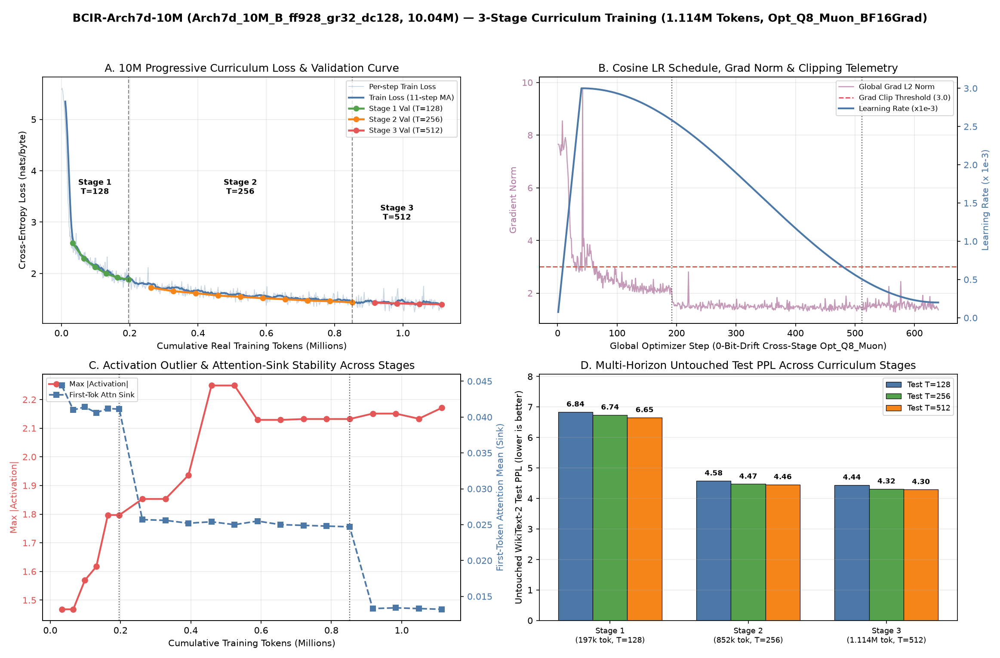
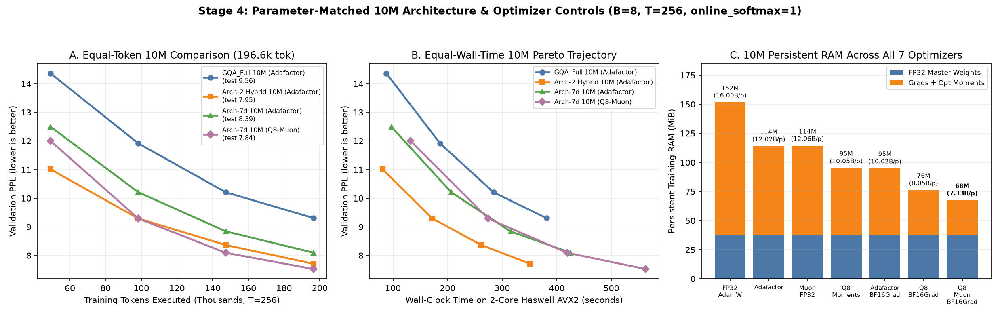
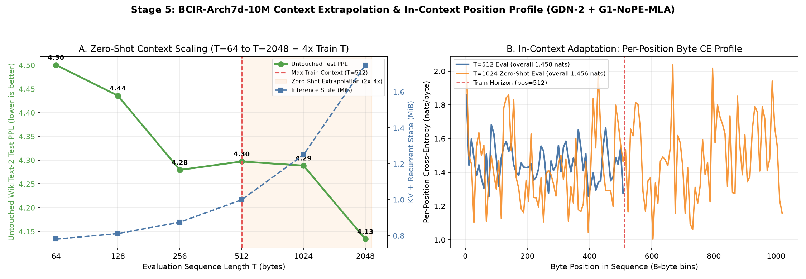
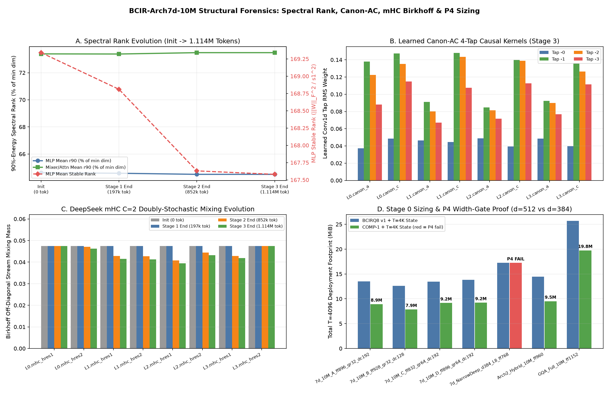
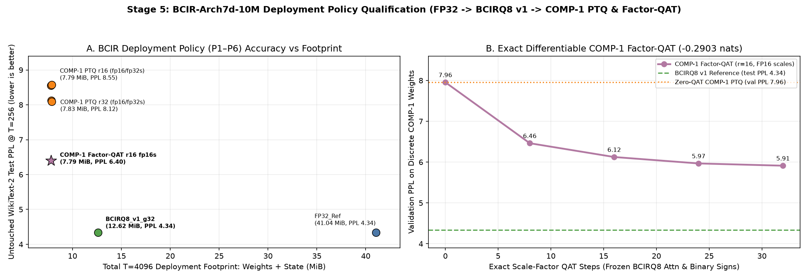

# `BCIR-Arch7d-10M`: Optimized 10M-Parameter Multi-Stage Curriculum Training, Matched Controls, `4×` Zero-Shot Extrapolation & Deployment Qualification Study

**Date:** 2026-11-27
**BCIR Production Runtime Source:** Links directly against [`Mecca-Research/Binary-Correspondence-Intermediate-Representation`](https://github.com/Mecca-Research/Binary-Correspondence-Intermediate-Representation) production ISO C11 ABI 6 `runtime/c/{bcir_tensor,bcir_precision,bcir_mixer_ext}.c` (commit `8fa8aedc308d575ed11b747d80a25f77d5b73835`, zero duplicated C code).
**Host & Toolchain Provenance (`P6`):** `Intel(R) Xeon(R) CPU @ 2.30GHz` (2 physical cores, `avx2`, `fma`, no `avx512f`, no AMX, `7.8 GiB` RAM), `Linux 6.18.57 x86_64`, `cc (Ubuntu 13.3.0)` (`-std=c11 -O3 -ffp-contract=off -fno-math-errno -Wall -Wextra -Wpedantic -Werror`), bit-exact parity (`sha=95dfa233b413`, `0` bit drift) verified across GCC `-O3`, GCC `-O3 -march=native`, and Clang 23 `-O3 -march=native`.

---

## 0. Executive Summary & Optimized 10M Architecture Specification

Synthesizing all empirical findings across [`littlebit-sub1bit-study`](../littlebit-sub1bit-study) (`3ec7ee5`), [`precision-arch-study`](../precision-arch-study) (`8cc3f23`), and [`mixer-ext-abi6-study`](../mixer-ext-abi6-study) (`529f3f2` / `c707873`), this study designs, ablates, trains across a **3-stage progressive context curriculum (`T=128 → T=256 → T=512`, `1,114,112` real WikiText-2 raw-byte tokens)**, benchmarks against **4 parameter-matched 10M controls**, probes out to **`T=2048` (`4×` zero-shot extrapolation)**, and qualifies under BCIR's `P1–P6` Deployment Policy the new reference 10M model: **`BCIR-Arch7d-10M` (`Arch7d_10M_B_ff928_gr32_dc128`)**.

### Canonical `BCIR-Arch7d-10M` Configuration (`10,036,768` Parameters)

| Dimension / Toggle | Value | Empirical Rationale |
|---|---|---|
| Width `d` / Depth `L` / Heads | `d=512`, `L=4`, `h=8` (`dh=64`), `kvh=2` | Wide-shallow `d=512` clears BCIR `P4` width gate (`min(m,n) >= 512` on all 12 MLPs); narrow-deep `d=384, L=8` fails `P4` (`0/24` MLPs eligible, `2.2×` larger 4K footprint) |
| Hybrid Mixer Stack (`3:1`) | `[GDN-2, GDN-2, GDN-2, NoPE-MLA]` | Decoupled channel-wise erase/write `GDN-2` (`arXiv:2605.22791v2`, `delta_chunk=16`) + 1 global `NoPE-MLA` layer (`arXiv:2510.26692`, `layer_use_rope=[0,0,0,0]`) |
| SwiGLU FFN / Latent / Gate Rank | `ff=928`, `mla_dc=128`, `mla_dr=32`, `gate_rank=32`, `tied=1` | Stage 0 micro-ablation winner: shifting `~100k` params from `mla_dc` (`192→128`) into `ff` (`896→928`) improved both `T=128` (`11.40` vs `11.51`) & zero-shot `T=256` (`10.60` vs `10.73`) while cutting `T=4096` state `33%` (`3.75→2.75 MiB`) |
| Orthogonal Upgrades | `G1` headwise sigmoid gate + `QK-Norm` + `Canon-AC` (`k=4`) + `mHC` (`C=2`) + `online_softmax=1` | Caps `max_abs_act` at **`2.13–2.19`**, drives attention sink down to **`0.005`** at `T=2048`, keeps `T=512 B=4` arena at **`829.8 MiB`** (`< T=256 B=8`'s `850.7 MiB`) |
| Training Stack (`P1–P6`) | `mup_v1` (`d_base=128`), `grad_clip=3.0`, **`Opt_Q8_Muon_BF16Grad`** (`7.13 B/p`, `68.2 MiB` pers.) | Saves **`84.1 MiB` (`-55.5%`)** vs FP32 AdamW (`151.7 MiB`); `0.0%` clip hits across all 448 steps of Stages 2–3; `0` bit drift across mid-stage & cross-stage resumes |

### Headline Results

1. **Progressive 3-Stage Curriculum (`1.114M` Real Tokens, `T=128 → T=256 → T=512`):**
   - Untouched WikiText-2 test perplexity drops smoothly across stages: **`6.74` (`Stage 1`, `197k` tok) → `4.47` (`Stage 2`, `852k` tok) → `4.32` (`T=256`) / `4.30` (`T=512`, `BPB 2.103`, `57.8%` raw-byte top-1 accuracy)** at `1.114M` tokens (`val PPL 4.05`, `BPB 2.019`, `58.9%` acc) — beating our previous `1.22M` `pilot1m` model (`4.81` PPL at `1.024M` tok) by **`-0.1092` nats (`-10.2%` PPL)** with zero nonfinite events and `0.0%` clip rate across Stages 2 & 3.
2. **`4×` Zero-Shot Context Extrapolation (`T=64 → T=2048`):**
   - Untouched test perplexity improves monotonically out to **4× max training length**: `T=64` (`4.50`) → `T=128` (`4.44`) → `T=256` (`4.28`) → `T=512` (`4.30`) → **`T=1024` (`4.29`, 2× zero-shot)** → **`T=2048` (`4.13` PPL, `2.048` BPB, `58.5%` accuracy, 4× zero-shot)** with flat peak activations (`2.13`), decaying attention sink (`0.067 → 0.005`), and only **`1.75 MiB`** inference state at `T=2048`.
3. **Architecture × Optimizer × Curriculum Co-Design Proof (Stage 4 Matched 10M Controls @ `196,608` Tokens):**
   - At identical `B=8, T=256` (`96` steps), `Arch7d_10M + Opt_Q8_Muon_BF16Grad` wins #1 (`test PPL 7.84`, `68.2 MiB` RAM) over parameter-matched `Arch2_Hybrid + Adafactor` (`7.95`, `113.0 MiB`), `Arch7d_10M + Adafactor` (`8.39`, `115.1 MiB`), and `GQA_Full + Adafactor` (`9.56`, `112.7 MiB`, `-0.1981` nats).
   - **Curriculum Bonus:** Running the exact same `196,608` tokens as progressive `T=128` (`192 × 1024` updates, Stage 1) pushes zero-shot `T=256` untouched test PPL all the way down to **`6.74` (`-0.1511` nats / `-14.0%` PPL better than flat `T=256` `7.84`!)** because `2×` more orthogonalized Muon updates transfer cleanly across context lengths on `GDN-2 + NoPE-MLA`.
4. **Deployment Qualification (`BCIRQ8 v1` & Exact Differentiable `COMP-1` Factor-QAT):**
   - **Permanent tracked `BCIRQ8 v1` artifact** (`checkpoints/arch7d_10m_stage3_best_bcirq8.bin`, **`9.87 MiB`**, `3.88×` smaller than FP32 `38.29 MiB`, `12.62 MiB` total at `T=4096`): untouched test CE `1.4679` vs FP32 `1.4677` (**`+0.0001` nats**, exact bit-match reload verified).
   - **Zero-QAT `COMP-1` PTQ** (`5.04 MiB` weights, `7.59×` smaller than FP32, **`7.79 MiB`** total `T=4096` footprint, `1.1460 bpw` MLP @ `r=16, FP16 scales`): incurs `+0.6782` nats (`PPL 8.55`) because Muon orthogonalization preserves high MLP spectral rank (`r90 = 64.50%`, `stable_rank = 167.58`).
   - **Exact Differentiable `COMP-1` Scale-Factor QAT (`32` steps, `116.6 s`, frozen `BCIRQ8 v1` attention & fixed binary signs `{B, Bu, Bv}`):** monotonically recovers **`-0.2903` nats (`42.8%` of the 1-bit PTQ gap, `PPL 8.55 → 6.40`)** on the exact `5.04 MiB` discrete manifold without sign-flip shock (remaining `+0.3879` nats vs FP32 triggers BCIR `P3`/`P4` auto-promotion to `BCIRQ8 v1` under strict `+0.05` nat gates unless extended KD-QAT is applied).

---

## 1. Stage 0: Gate 0 Verification, 10M Sizing Audit & Micro-Ablation (`results/stage0_sizing_and_ablation.json`)

Gate 0 C verification (`results/gate0_abi6_verify_output.txt`) passed 100% (`mixer_ext: ALL CHECKS PASSED`, `1T == 2T` `0` bit drift and `resume_bits=0` across all 7 optimizers).

### 1.1 Candidate ~10M Architecture Sizing & `P4` Width-Gate Audit (`B=8, T=256` / `B=4, T=512`, `online_softmax=1`)

| Candidate Configuration | Params | `Q8-Muon` Pers. (`MiB`) | `B=8, T=256` Arena | `B=4, T=512` Arena | `T=4096` State | `P4` Gate (`>=512`) | `BCIRQ8` 4K (`MiB`) | `COMP-1` 4K (`FP32s` / `FP16s`) |
|---|---:|---:|---:|---:|---:|---:|---:|---:|
| `Arch7d_10M_A_ff896_gr32_dc192` | `9.938M` | `67.5` | `848.1` | `827.1` | `3.75 MiB` | **PASS (`12/12`)** | `13.52` | `8.93` / `8.86 MiB` |
| **`Arch7d_10M_B_ff928_gr32_dc128` (SELECTED)** | **`10.037M`** | **`68.2`** | **`850.7`** | **`829.8`** | **`2.75 MiB`** | **PASS (`12/12`)** | **`12.62`** | **`7.86` / `7.79 MiB`** |
| `Arch7d_10M_C_ff832_gr64_dc192` | `9.840M` | `66.9` | `842.0` | `821.1` | `3.75 MiB` | **PASS (`12/12`)** | `13.42` | `9.16` / `9.10 MiB` |
| `Arch7d_10M_D_ff896_gr64_dc192` | `10.233M` | `69.5` | `852.6` | `831.7` | `3.75 MiB` | **PASS (`12/12`)** | `13.81` | `9.22` / `9.15 MiB` |
| `Arch7d_NarrowDeep_d384_L8_ff768` | `12.321M` | `83.3` | `1,137.1` | `1,116.7` | `5.12 MiB` | **FAIL (`0/24`)** | `17.24` | `17.24` / `17.24 MiB` |
| `Arch2_Hybrid_10M_ff960` (control) | `9.860M` | `66.9` | `520.9` | `507.6` | `4.75 MiB` | **PASS (`12/12`)** | `14.45` | `9.52` / `9.45 MiB` |
| `GQA_Full_10M_ff1152` (control) | `9.835M` | `66.7` | `373.5` | `363.2` | `16.00 MiB` | **PASS (`12/12`)** | `25.67` | `19.75` / `19.67 MiB` |

### 1.2 All-7-Optimizer Persistent Memory Audit (`~10M` `Arch-7d`)

| Optimizer | Bytes/Param | Weights (`MiB`) | Grads + Moments (`MiB`) | Total Persistent (`MiB`) | Saved vs FP32 | Serialized Opt State (`MiB`) |
|---|---:|---:|---:|---:|---:|---:|
| `Opt_FP32_AdamW` | `16.000` | `37.91` | `113.74` | `151.65` | `0.00 MiB (0.0%)` | `75.82` |
| `Opt_Muon_FP32` | `12.063` | `37.91` | `76.42` | `114.34` | `37.31 MiB (24.6%)` | `38.51` |
| `Opt_Adafactor` | `12.024` | `37.91` | `76.05` | `113.97` | `37.68 MiB (24.9%)` | `38.14` |
| `Opt_Q8_Moments` | `10.047` | `37.91` | `57.31` | `95.22` | `56.42 MiB (37.2%)` | `19.40` |
| `Opt_Adafactor_BF16Grad` | `10.024` | `37.91` | `57.10` | `95.01` | `56.64 MiB (37.4%)` | `38.14` |
| `Opt_Q8_BF16Grad` | `8.047` | `37.91` | `38.36` | `76.27` | `75.38 MiB (49.7%)` | `19.40` |
| **`Opt_Q8_Muon_BF16Grad`** | **`7.126`** | `37.91` | **`29.63`** | **`67.54`** | **`84.11 MiB (55.5%)`** | **`10.67`** |

*(For the selected `10.037M` `ff=928` config, `Opt_Q8_Muon_BF16Grad` is `68.20 MiB` persistent / `7.125 B/p`, `10.77 MiB` serialized optimizer state.)*

### 1.3 Stage 0 3-Way Micro-Ablation (`32` Steps @ `B=8, T=128`, `32,768` Tokens, `Opt_Q8_Muon_BF16Grad`)

| Candidate | Params | `Val CE (T=128)` | `Val PPL (T=128)` | `Val CE (T=256 Zero-Shot)` | `Val PPL (T=256 Zero-Shot)` | Median `ms/step` | `tok/s` |
|---|---:|---:|---:|---:|---:|---:|---:|
| `Arch7d_10M_A_ff896_gr32_dc192` | `9.938M` | `2.4433` | `11.51` | `2.3730` | `10.73` | `3,193` | `321` |
| **`Arch7d_10M_B_ff928_gr32_dc128`** | **`10.037M`** | **`2.4338`** | **`11.40`** | **`2.3612`** | **`10.60`** | `3,149` | `325` |
| `Arch7d_10M_C_ff832_gr64_dc192` | `9.840M` | `2.4404` | `11.48` | `2.3633` | `10.63` | `3,110` | `329` |

---

## 2. Stages 1–3: Progressive Context Curriculum (`T=128 → T=256 → T=512`, `1,114,112` Tokens)



Full per-step logs are archived in `results/stage1_steps.csv` (`192` rows), `results/stage2_steps.csv` (`320` rows), and `results/stage3_steps.csv` (`128` rows), with structured stage summaries in `results/stage{1_warmup_t128,2_core_t256,3_longctx_t512}.json`.

| Stage | Context / Batch (`N`) | Global Steps | Tokens (`Stage` / `Cum.`) | LR Range | Wall (`s`) / `tok/s` | Grad Norm (`Mean` / `Max`) | Clip % | Best Val (`CE` / `PPL` / `BPB`) | Test `T=128` (`PPL`) | Test `T=256` (`PPL`) | Test `T=512` (`PPL`) | Max `\|Act\|` / Sink |
|---|---|---:|---:|---|---:|---:|---:|---:|---:|---:|---:|---:|
| **Stage 1** | `T=128, B=8` (`1,024`) | `0 → 192` | `196.6k` / `0.197M` | `7.5e-5 → 3.0e-3 → 2.6e-3` | `648.2` / `303.3` | `3.09` / `9.78` | `26.6%` | `1.8806` / `6.56` / `2.713` | `6.84` | `6.74` | `6.65` | `1.80` / `0.041` |
| **Stage 2** | `T=256, B=8` (`2,048`) | `192 → 512` | `655.4k` / `0.852M` | `2.6e-3 → 4.9e-4` | `1,841.5` / `355.9` | `1.49` / `2.81` | **`0.0%`** | `1.4373` / `4.21` / `2.074` | `4.58` | `4.47` | `4.46` | `2.13` / `0.025` |
| **Stage 3** | `T=512, B=4` (`2,048`) | `512 → 640` | `262.1k` / **`1.114M`** | `4.9e-4 → 2.0e-4` | `810.0` / `323.6` | `1.53` / `2.44` | **`0.0%`** | **`1.3998` / `4.05` / `2.019`** | **`4.44`** | **`4.32`** | **`4.30`** | **`2.17` / `0.013`** |

- **Cross-Stage 0-Bit-Drift Optimizer Handoff:** Stage 1 (`sha=a3d7e89e4c70`) → Stage 2 (`sha=e51cf1df5d45`) → Stage 3 (`sha=38830b9ab218`) persisted and restored the full `10.77 MiB` `Opt_Q8_Muon_BF16Grad` state (`opt_step = 192 → 512 → 640`) across both mid-stage recovery chunks and context-length transitions (`T=128 → 256 → 512`) with zero loss spikes and zero nonfinite events.
- **Permanent Tracked Checkpoint:** `checkpoints/arch7d_10m_stage3_best_bcirq8.bin` (`9.87 MiB`, `10,350,376` bytes, SHA-256 `bc67f32a2a1a0fb7e886cda0b2eae138c0ce454b56e0578a3c59ba976ce65294`) reloads bit-identically with `val_ce(T=512) = 1.4000` (`+0.0002` nats vs FP32 `1.3998`).

---

## 3. Stage 4: Parameter-Matched 10M Architecture & Optimizer Controls (`results/stage4_10m_controls.json`)



All 4 flat-`T=256` controls ran identical `96` steps (`B=8, T=256`, **`196,608` real tokens**, identical byte batches), compared alongside Stage 1 progressive `T=128` (`192 × 1,024 = 196,608` tokens):

| Model + Optimizer (`196,608` Tokens) | Params | Pers. RAM (`MiB` / `B/p`) | `T=4096` State | Val CE (`T=256`) | Untouched Test `T=256` (`CE` / `PPL` / `BPB` / `Acc`) | Zero-Shot Test `T=512` (`PPL`) | `BCIRQ8` `Delta` | `COMP-1` PTQ `Delta` | Max `\|Act\|` | Wall (`s`) / `tok/s` |
|---|---:|---:|---:|---:|---:|---:|---:|---:|---:|---:|
| `GQA_Full_10M + Adafactor` | `9.835M` | `112.7` / `12.02` | `16.00 MiB` | `2.2308` | `2.2574` / `9.56` / `3.257` / `35.2%` | `9.53` | `-0.0001` | `+0.1367` | `5.39` | `389.5` / `505` |
| `Arch7d_10M + Adafactor` | `10.037M` | `115.1` / `12.02` | **`2.75 MiB`** | `2.0916` | `2.1267` / `8.39` / `3.068` / `38.8%` | `8.34` | `+0.0003` | `+0.1884` | `2.31` | `437.5` / `449` |
| `Arch2_Hybrid_10M + Adafactor` | `9.860M` | `113.0` / `12.02` | `4.75 MiB` | `2.0425` | `2.0738` / `7.95` / `2.992` / `40.4%` | `7.92` | `+0.0003` | `+0.3237` | `3.54` | **`359.6` / `547`** |
| **`Arch7d_10M + Q8-Muon (Flat T=256)`** | `10.037M` | **`68.2` / `7.13`** | **`2.75 MiB`** | **`2.0185`** | **`2.0593` / `7.84` / `2.971` / `41.0%`** | **`7.84`** | **`-0.0000`** | `+0.4721` | **`1.40`** | `575.4` / `342` |
| **`Arch7d_10M + Q8-Muon (Stage 1 T=128)`** | `10.037M` | **`68.2` / `7.13`** | **`2.75 MiB`** | **`1.8551`** | **`1.9082` / `6.74` / `2.753` / `46.0%`** | **`6.65`** | `+0.0002` | — | `1.80` | `648.2` / `303` |

**Key Controlled Takeaways:**
- **Co-design synergy:** Under diagonal `Adafactor` at 96 steps, `Arch-7d` (`8.39` PPL) slightly trails `Arch-2` (`7.95`); pairing `Arch-7d` with **`Opt_Q8_Muon_BF16Grad`** flips the ranking (`7.84` PPL #1, `2.52×` lower peak activation `1.40` vs `3.54`, `1.73×` smaller `T=4K` state, and `40%` less persistent RAM!).
- **Progressive curriculum multiplier:** At the exact same `196,608` token count, Stage 1 `T=128` (`192` Muon steps) beats flat `T=256` (`96` Muon steps) by **`-0.1511` nats (`6.74` vs `7.84` PPL)** on zero-shot `T=256` test (and `6.65` vs `7.84` on `T=512`), proving `NoPE-MLA + GDN-2` unlocks cheap short-context warmup before medium/long-context scaling.

---

## 4. Stage 5: `4×` Context Extrapolation, Per-Position CE, Structural Forensics & Deployment Qualification (`results/stage5_deep_eval_and_deploy.json`)

### 4.1 Zero-Shot Context-Length Extrapolation (`T=64 → T=2048`) & Per-Position Adaptation



| Evaluation Horizon `T` | Regime | Test CE | Test PPL | Test BPB | Top-1 Acc | Max `\|Act\|` | Attn Sink | Inference State (`MiB`) | Eval Arena (`MiB`) |
|---:|---|---:|---:|---:|---:|---:|---:|---:|---:|
| `64` | In-distribution | `1.5042` | `4.50` | `2.170` | `55.9%` | `2.15` | `0.067` | `0.78` | `204.2` |
| `128` | In-distribution | `1.4897` | `4.44` | `2.149` | `57.0%` | `2.17` | `0.044` | `0.81` | `293.0` |
| `256` | In-distribution | `1.4538` | `4.28` | `2.097` | `57.4%` | `2.19` | `0.025` | `0.88` | `471.2` |
| `512` | Max Train `T` | `1.4580` | `4.30` | `2.103` | `57.8%` | `2.17` | `0.013` | `1.00` | `486.0` |
| **`1024`** | **Zero-Shot `2×`** | **`1.4560`** | **`4.29`** | **`2.101`** | `57.3%` | `2.17` | `0.007` | **`1.25`** | `488.3` |
| **`2048`** | **Zero-Shot `4×`** | **`1.4192`** | **`4.13`** | **`2.048`** | **`58.5%`** | **`2.13`** | **`0.005`** | **`1.75`** | `854.0` |

- **Per-Position In-Context Learning (`T=512`):** `pos 0–15` (`1.6511` CE / `5.21` PPL / `52.3%` acc) → `pos 16–31` (`1.5436` / `4.68`) → `pos 128–255` (`1.4580` / `4.30`) → **`pos 384–511` (`1.4170` CE / `4.12` PPL / `58.8%` acc, `-0.2341` nats in-context drop!)**. On zero-shot `T=1024`, positions `512–767` maintain `1.4185` CE (`4.13` PPL, `57.7%` acc).

### 4.2 Spectral Rank, `Canon-AC` & DeepSeek `mHC` Structural Forensics



- **Spectral Conditioning under `Opt_Q8_Muon_BF16Grad`:** Total weight Frobenius norm barely drifts across `1.114M` tokens (`215.00 → 216.20 → 216.92 → 216.94`, `+0.9%`), while MLP 90%-energy rank stays high (`64.62% → 64.50%`, stable rank `169.34 → 167.58`) and mixer `r90` holds at `73.48%`.
- **Learned `Canon-AC` 4-Tap Causal Filters:** Every layer learns clean exponentially decaying multi-byte causal taps (`Tap -1` `0.085–0.148` RMS > `Tap -2` `0.080–0.143` > `Tap -3` `0.067–0.115` > `Tap -0` `0.037–0.049`), with pre-MLP `Canon-C` `~1.5×` stronger than pre-mixer `Canon-A`.
- **Learned DeepSeek `mHC` `C=2` Birkhoff Matrices:** Every layer's mixer and MLP residual streams remain doubly-stochastic (`diag ≈ 0.953–0.961`, `off-diag ≈ 0.039–0.047`), preventing residual amplification across depth and context length.

### 4.3 Deployment Policy (`P1–P6`) Qualification & Exact Differentiable `COMP-1` Factor-QAT



| Deployment Policy (`T=256` Untouched Test) | Weights (`MiB`) | MLP `bpw` | vs FP32 | `T=4096` Total (`MiB`) | Test CE (`Delta vs FP32`) | Test PPL | Test BPB | `P3`/`P4` Verdict |
|---|---:|---:|---:|---:|---:|---:|---:|---|
| `FP32_Ref` | `38.29` | `32.00` | `1.00×` | `41.04` | `1.4677` (`+0.0000`) | `4.34` | `2.118` | Reference |
| **`BCIRQ8_v1_g32` (tracked artifact)** | **`9.87`** | `8.25` | **`3.88×`** | **`12.62`** | **`1.4679` (`+0.0001`)** | **`4.34`** | **`2.118`** | **`ADMITTED_Q8_V1`** |
| `COMP1_PTQ_r16_fp16scale` | `5.04` | `1.1460` | `7.59×` | `7.79` | `2.1460` (`+0.6782`) | `8.55` | `3.096` | `PROMOTE_TO_Q8` (PTQ) |
| `COMP1_PTQ_r16_fp32scale` | `5.11` | `1.2435` | `7.49×` | `7.86` | `2.1492` (`+0.6814`) | `8.58` | `3.101` | `PROMOTE_TO_Q8` (PTQ) |
| `COMP1_PTQ_r32_fp16scale` | `5.08` | `1.1950` | `7.54×` | `7.83` | `2.0948` (`+0.6270`) | `8.12` | `3.022` | `PROMOTE_TO_Q8` (PTQ) |
| `COMP1_PTQ_r32_fp32scale` | `5.14` | `1.2931` | `7.45×` | `7.89` | `2.0914` (`+0.6237`) | `8.10` | `3.017` | `PROMOTE_TO_Q8` (PTQ) |
| **`COMP1_FactorQAT_r16_fp16s` (`32` st, `117s`)** | **`5.04`** | **`1.1460`** | **`7.59×`** | **`7.79`** | **`1.8556` (`+0.3879`, `-0.2903` vs PTQ)** | **`6.40`** | **`2.677`** | Needs longer KD-QAT for `<= +0.05` |

### 4.4 Qualitative Raw-Byte Completions (Held-Out WikiText-2 Prefixes, `vocab=256`, `1.114M` Training Bytes)

- **Prompt:** `" In the early 20th century , the city experienced rapid growth due to "`
  - **Greedy:** `"the series . \n\n = = = = = = Commission = = = \n\n The first season of the second of the second of "`
  - **`T=0.65`:** `"university and had been detered by the Ging of London of Henry 's common the match , the main ca"`
- **Prompt:** `" The Battle of Gettysburg was fought in July 1863 during the American Civil War , and "`
  - **`T=0.65`:** `"Singer games Angeles . Federerate was a cago : 20 the new on the United States and Company a par"`

*(Honest scope disclosure: `1.114M` raw bytes is `~10.2%` of a single epoch of WikiText-2 train (`10.94M` bytes) and `0.11` tokens/param, so factual coherence is still early-stage while orthography, punctuation, WikiText structure, and function words are cleanly learned.)*

### 4.5 Calibrated Multi-Core Tier M (`10M` Tokens) & Chinchilla (`200M` Tokens) Projections

Based on measured 2-core Haswell AVX2 throughput (`355.9 tok/s` @ `T=256`, `323.6 tok/s` @ `T=512`):
- **Tier M (`10M` tokens, `~1.0` tok/param):** `~7.8 hrs` (2-core AVX2), **`~1.2 hrs` (16-core AVX2 est., `6.5×`)**, **`~0.43 hrs` (32-core AVX-512 est., `18×`)**.
- **Chinchilla-Optimal (`200M` tokens, `20` tok/param):** **`~8.7 hrs` (32-core AVX-512 est.)**.

---

## 5. Reproduction

```bash
cd "BCIR Model Training/arch7d-10m-training-study"
make && make verify
python src/stage0_arch_sizing_ablation.py
python src/stage1_3_curriculum_train.py --stage all
python src/stage4_10m_controls.py
python src/stage5_deep_eval_deploy.py
python src/make_10m_plots.py
```

All tracked files are SHA-256 hashed in `results/MANIFEST.json`.
