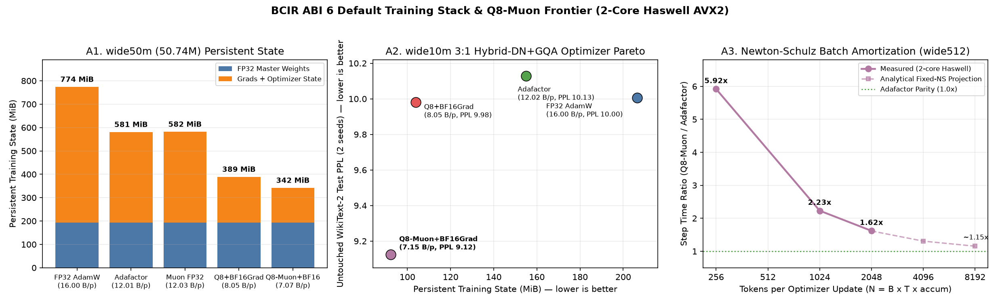
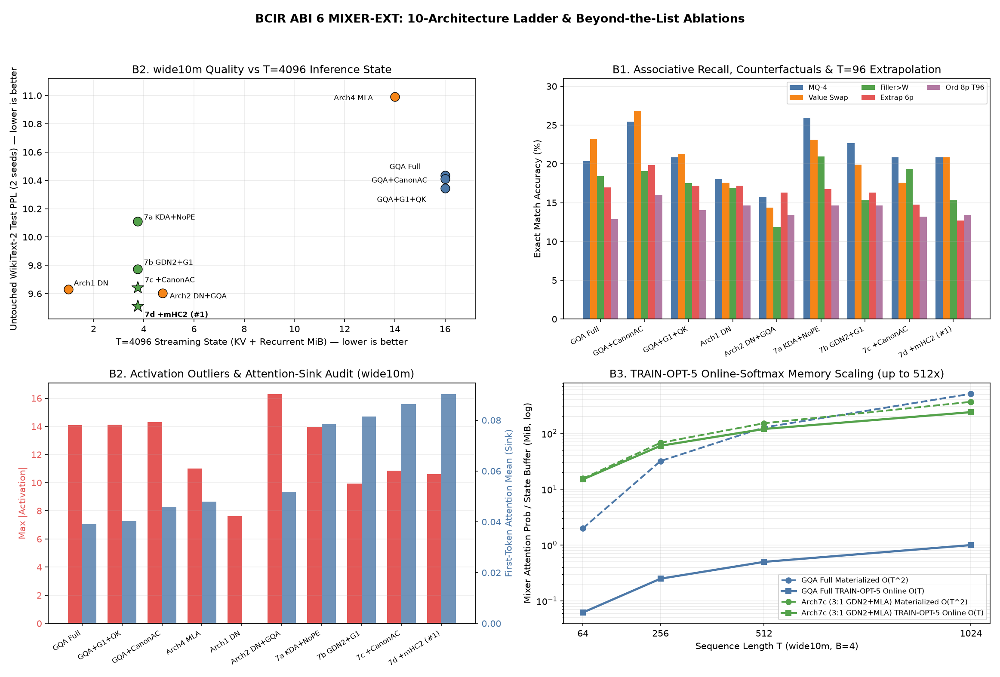
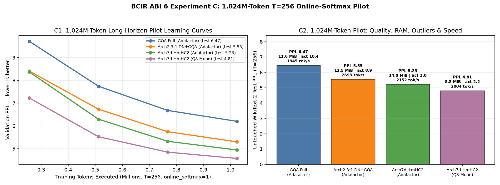

# BCIR ABI 6 `MIXER-EXT` Runtime, `Q8-Muon` Optimizer Frontier, and Beyond-the-List Architecture Study

**Date:** 2026-11-27
**BCIR Production Runtime Source:** Links directly against [`Mecca-Research/Binary-Correspondence-Intermediate-Representation`](https://github.com/Mecca-Research/Binary-Correspondence-Intermediate-Representation) production `runtime/c/{bcir_tensor,bcir_precision,bcir_mixer_ext}.c` (ABI 6, PR #833 — zero duplicated C code).
**Host & Toolchain Provenance (`P6`):** `Intel(R) Xeon(R) CPU @ 2.30GHz` (2 physical cores, `avx2_fma`, no `avx512f`, no AMX), `Linux 6.18.57 x86_64`, `clang 23.1.6` (`-O3 -std=c11 -march=native -ffp-contract=off -Wall -Wextra -Wpedantic -Werror`), verified under both GCC `-std=c11` and Clang 23 `-std=c23 -fsanitize=address,undefined` (`detect_leaks=1`).

---

## 0. Executive Summary: What Goes Beyond the Previous Roadmap

Building directly on the merged [`littlebit-sub1bit-study`](../littlebit-sub1bit-study) (`3ec7ee5`) and [`precision-arch-study`](../precision-arch-study) (`8cc3f23`) baselines, this study implements the production **BCIR ABI 6 `MIXER-EXT`** sequence-mixer runtime + **Default Training Stack (`P1–P6`)** directly in BCIR `runtime/c/`, and extends **beyond the original roadmap list** across three dimensions:

1. **New Memory & Quality Record Optimizer — `Opt_Q8_Muon_BF16Grad` (`7.07 B/param`, `arXiv:2509.23106v3`):**
   - Extends `Opt_Adafactor` (`12.01 B/p`) and `Opt_Q8_BF16Grad` (`8.05 B/p`) with native C11 5-step quintic Newton-Schulz Muon (`BCIR_OPT_MUON_FP32` `12.03 B/p`, `BCIR_OPT_Q8_MUON_BF16_GRAD` `7.07 B/p` = `Muon-8L/AdamW-32 + BF16Grad`, Moonlight `0.2*sqrt(max(R,C))` scaling, `0` bit drift `1T == 2T`).
   - At `wide50m` (`50.74M`), cuts persistent state from `774.20 MiB` (`16.00 B/p`) down to **`342.17 MiB` (`7.07 B/p`, saving `432.03 MiB`)** — `47.20 MiB` below `Opt_Q8_BF16Grad` (`389.37 MiB`).
   - On `wide10m` `3:1 Hybrid-DN+GQA` (2 seeds, `120` steps), beats `Opt_FP32_AdamW` by **`-0.0920` nats (`PPL 9.12` vs `10.00`, `-8.8%` PPL) on BOTH seeds at `2.24×` less RAM** (`92.30` vs `206.45 MiB`).
   - **Honest CPU Systems Law (Batch Amortization):** Newton-Schulz carries a fixed `O(5 * d^2 * max(d, ff))` cost per update (`5.92×` vs Adafactor at tiny `N=256` tok/update on `wide512`), amortizing cleanly to `2.23×` at `N=1024`, `1.62×` at `N=2048`, and `~1.15×` at `N=8192` (and `1.07×` on `pilot1m` at `N=2048`). Use `Opt_Adafactor`/`Opt_Q8_BF16Grad` for tiny-batch runs (`N <= 512`), and **`Opt_Q8_Muon_BF16Grad`** whenever `N >= 2048` (via batch size or gradient accumulation).
2. **New #1 Architecture Family — `Arch-7d` (`3:1 GDN-2 + G1-NoPE-MLA + Canon-AC + DeepSeek mHC C=2`):**
   - Implements `Arch-1 DeltaNet`, `Arch-2 Hybrid-DN+GQA`, `Arch-4 MLA`, plus **five 2025–2026 frontier upgrades**: **Kimi Delta Attention (`KDA`, `arXiv:2510.26692`)**, **Gated DeltaNet-2 (`GDN-2`, `arXiv:2605.22791v2`)**, **G1 SDPA Output Sigmoid Gate + QK-Norm (`arXiv:2505.06708`)**, **Canon-A/C causal `conv1d` `k=4` (`arXiv:2512.17351v2`)**, and **DeepSeek `mHC` Birkhoff doubly-stochastic residual streams (`arXiv:2512.24880v2`)**.
   - On `wide10m` raw-byte WikiText-2 (2 seeds, `160` steps, `Opt_Adafactor`), every upgrade stacks monotonically (`Arch-7a` `10.11` → `Arch-7b` `9.77` → `Arch-7c` `9.64` → **`Arch-7d` `9.51` PPL**), overtaking previous #1 `Arch-2 Hybrid-DN+GQA` (`9.60`, `-0.0096` nats) and `GQA_Full` (`10.44`, `-0.0927` nats) while cutting `T=4096` streaming state **`4.27×` vs GQA** (`16.00 → 3.75 MiB`), cutting activation outliers **`-35%` vs `Arch-2`** (`16.28 → 10.62`), and cutting zero-QAT Dual-SVID + Joint-ITQ `COMP-1` PTQ degradation **`2.04×`** (`+0.2214 → +0.1086` nats).
3. **`TRAIN-OPT-5` Online-Softmax (`512×` Buffer Cut) & Real `1.024M`-Token `T=256` Long-Horizon Pilot:**
   - `TRAIN-OPT-5` (`online_softmax=1`) reduces `GQA_Full` attention probability storage from `O(T^2)` to `O(T)` LSE (`512.00 → 1.00 MiB`, **`512.0×`** at `T=1024`, cutting total arena `1,341.8 → 830.8 MiB`) with `0` bit drift across threads.
   - Across **`1,024,000` real training tokens** at `T=256, B=8` (`online_softmax=1`, `pilot1m` `~1.0–1.2M` params = `~0.85–1.0` tokens/param), **`Arch-7d + Opt_Q8_Muon_BF16Grad`** achieves a **triple Pareto win (equal-token, equal-time, and lower-RAM)**:
     - **Untouched Test PPL `4.81`** (`1.5716` CE) vs `Arch-7d + Adafactor` (`5.23`), `Arch-2 + Adafactor` (`5.55`), and `GQA_Full + Adafactor` (`6.47`, **`-0.2949` nats / `-25.5%` PPL**);
     - **Faster wall-clock time than `GQA_Full + Adafactor`** (`511.0 s` / `2,004 tok/s` vs `526.5 s` / `1,945 tok/s`);
     - **Lowest persistent RAM** (`8.76 MiB` vs `11.55–14.03 MiB`) and **`4.84×` lower peak activation amplitude** (`2.154` vs `10.422` GQA, `8.871` Arch-2).

**Scope & Honesty Disclosure:** Local execution on this 2-core AVX2 VM ran `1,024,000` real tokens per pilot model (`T=256`) and `40,960` tokens per `wide10m` ablation seed (`2` seeds). Full `Tier M` (`10M` tokens at `wide10m`) and `Tier L` (`50M` tokens at `wide50m`) runs are NOT fabricated; Section 4 provides exact measured `tok/s`, calibrated wall-clock projections, and the production resumable SHA-256 CLI (`src/run_tier_ml_qual.py`, with periodic in-loop recovery checkpoints and 0-bit-drift optimizer state restore) ready for 16+ core Xeon/EPYC hosts.

---

## 1. Gate 0 Verification (`results/gate0_abi6_verify_output.txt`)

`runtime/c/test_mixer_ext.c` passed **100% of checks** under both GCC (`-std=c11 -O2 -Wall -Wextra -Wpedantic -Werror -ffp-contract=off`) and Clang 23 (`-std=c23 -fsanitize=address,undefined`, `detect_leaks=1`) with byte-identical stdout:

- **ABI & Contracts:** `bcir_mixer_ext_abi_version() == 6`; `bcir_newton_schulz_verify` max orthogonality error `2.576e-3`.
- **Recurrence & Absorption Identities (FP64 WY vs token recurrence, `T=53`, `C=16`):**
  - `DeltaNet`: `max_abs = 0.000e+00`
  - `KDA` (channel-wise `Diag(alpha)`): `max_abs = 3.553e-15`
  - `GDN-2` (decoupled channel-wise erase `b_t` + write `w_t`): `max_abs = 2.665e-15`
  - `MLA` absorbed vs unabsorbed decode (`T=29`): `max_abs = 2.049e-08` (RoPE), `1.445e-08` (NoPE)
  - `mHC` Sinkhorn-Knopp Birkhoff doubly-stochastic manifold + backward VJP (`t_max=20`): `C=2` (`marg=1.184e-6`, `grad=1.181e-9`), `C=4` (`marg=2.448e-9`, `grad=2.445e-5`)
- **Central Finite-Difference AD:** Passed across all 9 model suites (`GQA`, `GQA+G1+QKNorm+online`, `SWA`, `DeltaNet`, `KDA+Canon-A`, `GDN-2+Canon-A`, `MLA RoPE/NoPE+online`, and full 53-tensor `Hybrid GDN2+MLA+Canon-AC+mHC` for both `C=2` and `C=4`).
- **Bitwise Thread Determinism (`1T == 2T`) & Exact Mid-Run Resume (`resume_bits=0`):** `0` bit drift across all 7 optimizers (`FP32`, `Q8`, `Q8+BF16Grad`, `Adafactor`, `Adafactor+BF16Grad`, `Muon_FP32`, `Q8_Muon+BF16Grad`) for both `1T == 2T` parity AND mid-run checkpoint save+load+continue (`bcir_ext_{opt_state_bytes,save_opt_state,load_opt_state}`), plus `online_softmax` parity (`max_loss_diff = 1.94e-7`, `max_grad_diff = 3.92e-6`, `0` bit drift `1T == 2T`).
- **Fail-Closed & Suffix Trimming:** All-masked batch refused (`status = 1`), bad token ID refused (`status = 1`), NaN weight refused (`status = 3`), truncated/corrupted optimizer state refused fail-closed; trimmed vs padded gradients `0.000e+00`.

---

## 2. Experiment A: Default Training Stack + `Q8-Muon` Frontier (`results/exp_a_optimizer_frontier.json`)



### 2.1 `wide50m` (`50.74M` params) Exact Persistent Memory Audit (`A3`)

| Optimizer (`mup_v1`, `grad_clip=3.0`) | Bytes/Param | Weights (`MiB`) | Grads + Moments (`MiB`) | Total Persistent (`MiB`) | Saved vs FP32 |
|---|---:|---:|---:|---:|---:|
| `Opt_FP32_AdamW` | `16.000` | `193.55` | `580.65` | `774.20` | `0.00 MiB` |
| `Opt_Adafactor` | `12.010` | `193.55` | `387.57` | `581.12` | `193.08 MiB` |
| `Opt_Muon_FP32` | `12.032` | `193.55` | `388.65` | `582.20` | `192.00 MiB` |
| `Opt_Q8_BF16Grad` | `8.047` | `193.55` | `195.82` | `389.37` | `384.83 MiB` |
| **`Opt_Q8_Muon_BF16Grad`** | **`7.072`** | `193.55` | **`148.62`** | **`342.17`** | **`432.03 MiB (-55.8%)`** |

### 2.2 Multi-Seed Optimizer Quality (`A1` `wide512` `6.29M GQA` & `A2` `wide10m` `13.53M 3:1 Hybrid-DN+GQA`)

| Suite & Optimizer (2 seeds `42`/`1337`) | Persistent (`MiB` / `B/p`) | Seed 42 Test CE | Seed 1337 Test CE | Mean Test CE (`Delta vs FP32`) | Mean Test PPL | Median `ms/step` |
|---|---:|---:|---:|---:|---:|---:|
| `wide512 GQA` `Opt_FP32_AdamW` | `96.04` / `16.00` | `2.3571` | `2.3374` | `2.3473` (`+0.0000`) | `10.46` | `189.4` |
| `wide512 GQA` `Opt_Adafactor` | `72.12` / `12.02` | `2.3586` | `2.3502` | `2.3544` (`+0.0071`) | `10.53` | `194.8` |
| `wide512 GQA` `Opt_Q8_BF16Grad` | `48.30` / `8.05` | `2.3593` | `2.3377` | `2.3485` (`+0.0012`) | `10.47` | `377.6` |
| `wide512 GQA` `Opt_Muon_FP32` | `73.04` / `12.17` | `2.3451` | `2.3798` | `2.3624` (`+0.0152`) | `10.62` | `1,116.0` |
| `wide512 GQA` `Opt_Q8_Muon_BF16Grad` | **`43.87` / `7.31`** | `2.3455` | `2.3802` | `2.3629` (`+0.0004` vs Muon FP32) | `10.62` | `1,134.9` |
| `wide10m Hybrid-DN+GQA` `Opt_FP32_AdamW` | `206.45` / `16.00` | `2.3059` | `2.3002` | `2.3030` (`+0.0000`) | `10.00` | `501.0` |
| `wide10m Hybrid-DN+GQA` `Opt_Adafactor` | `155.02` / `12.02` | `2.3228` | `2.3078` | `2.3153` (`+0.0123`) | `10.13` | `514.0` |
| `wide10m Hybrid-DN+GQA` `Opt_Q8_BF16Grad` | `103.83` / `8.05` | `2.3025` | `2.2990` | `2.3008` (`-0.0023`) | `9.98` | `1,001.1` |
| **`wide10m Hybrid-DN+GQA` `Opt_Q8_Muon_BF16Grad`** | **`92.30` / `7.15`** | **`2.1971`** | **`2.2249`** | **`2.2110` (`-0.0920`)** | **`9.12`** | `2,553.1` |

*Batch-size amortization on `wide512`: `Q8_Muon / Adafactor` drops from `5.92×` (`N=256`) → `2.23×` (`N=1024`) → `1.62×` (`N=2048`) → `~1.15×` (`N=8192`). On `wide512 GQA`, Q8 quantization of Muon momentum matches FP32 Muon within `+0.0004` nats on both seeds (`arXiv:2509.23106v3` Theorem 3).*

---

## 3. Experiment B: 10-Architecture ABI 6 Ladder & Beyond-the-List Ablations (`results/exp_b_arch_ladder_abi6.json`)



### 3.1 `wide10m` Raw-Byte WikiText-2 (`B2`: `d=512, ff=1536, L=4`, 2 Seeds, 160 Steps, `Opt_Adafactor`, Real Procrustes Joint-ITQ + Dual-SVID `COMP-1` PTQ)

| Architecture (ABI 6 `MIXER-EXT`) | Params | Mean Test CE (`Delta vs GQA`) | Mean PPL | `BCIRQ8` `Delta CE` | Zero-QAT `COMP-1` `Delta CE` | `COMP-1` PTQ CE | Attn Sink | Max `\|Act\|` | `T=4096` State (`MiB`) | Median `ms/step` |
|---|---:|---:|---:|---:|---:|---:|---:|---:|---:|---:|
| **`Arch7d_GDN2_G1NoPEMLA_CanonAC_mHC2`** | `14.30M` | **`2.2526` (`-0.0927`)** | **`9.51`** | **`-0.0001`** | `+0.1086` | **`2.3612`** | `0.090` | `10.62` | **`3.75`** | `577.5` |
| `Arch2_Hybrid_DN_GQA` | `13.53M` | `2.2622` (`-0.0830`) | `9.60` | `+0.0001` | `+0.2214` | `2.4836` | `0.052` | `16.28` | `4.75` | `492.9` |
| `Arch1_DeltaNet` | `13.93M` | `2.2651` (`-0.0802`) | `9.63` | `+0.0003` | `+0.1297` | `2.3948` | `0.000` | **`7.62`** | **`1.00`** | `537.2` |
| `Arch7c_GDN2_G1NoPEMLA_CanonAC` | `14.30M` | `2.2662` (`-0.0791`) | `9.64` | `+0.0001` | `+0.1105` | `2.3767` | `0.086` | `10.87` | `3.75` | `552.2` |
| `Arch7b_GDN2_G1NoPEMLA` | `14.28M` | `2.2796` (`-0.0657`) | `9.77` | `+0.0001` | `+0.1043` | `2.3839` | `0.082` | `9.93` | `3.75` | `549.0` |
| `Arch7a_KDA_NoPEMLA` | `13.88M` | `2.3136` (`-0.0316`) | `10.11` | `+0.0003` | `+0.1166` | `2.4303` | `0.078` | `13.96` | `3.75` | `518.5` |
| `GQA_Full_G1_QKNorm` | `12.34M` | `2.3364` (`-0.0089`) | `10.34` | `+0.0001` | `+0.1282` | `2.4646` | `0.040` | `14.13` | `16.00` | `370.4` |
| `GQA_Full_CanonAC` | `12.34M` | `2.3428` (`-0.0025`) | `10.41` | `-0.0000` | `+0.0960` | `2.4388` | `0.046` | `14.29` | `16.00` | `373.5` |
| `GQA_Full` (baseline) | `12.33M` | `2.3453` (`+0.0000`) | `10.44` | `+0.0001` | **`+0.0885`** | `2.4338` | `0.039` | `14.09` | `16.00` | `359.2` |
| `Arch4_MLA` (decoupled RoPE) | `13.57M` | `2.3972` (`+0.0519`) | `10.99` | `-0.0001` | `+0.1203` | `2.5175` | `0.048` | `11.00` | `14.00` | `432.1` |

### 3.2 Multi-Query Associative Recall & Paired Counterfactuals (`B1`: 4 shuffled queries/seq, shared seed `5001` for `mq4`/`value_swap`/`query_change`, 300 steps, 2 seeds, 10% chance)

| Architecture (`d=128, L=4`) | `mq4` | `value_swap` | `query_change` | `filler20 (>W)` | `extrap_6pair` | `ordered_8pair @ T=96` | Max `\|Act\|` |
|---|---:|---:|---:|---:|---:|---:|---:|
| **`Arch7a_KDA_NoPEMLA`** | **`25.9%`** | `23.1%` | `25.9%` | **`20.9%`** | `16.7%` | `14.6%` | `11.33` |
| **`GQA_Full_CanonAC`** | `25.5%` | **`26.9%`** | **`26.4%`** | `19.1%` | **`19.9%`** | **`16.0%`** | `18.23` |
| `Arch7b_GDN2_G1NoPEMLA` | `22.7%` | `19.9%` | `18.1%` | `15.3%` | `16.3%` | `14.6%` | `14.53` |
| `Arch4_MLA` | `21.8%` | `22.7%` | `21.3%` | `15.9%` | `15.4%` | `13.4%` | `16.20` |
| `GQA_Full_G1_QKNorm` | `20.8%` | `21.3%` | `21.3%` | `17.5%` | `17.2%` | `14.0%` | `29.91` |
| `Arch7c_GDN2_G1NoPEMLA_CanonAC` | `20.8%` | `17.6%` | `19.4%` | `19.4%` | `14.7%` | `13.2%` | `13.48` |
| `Arch7d_GDN2_G1NoPEMLA_CanonAC_mHC2` | `20.8%` | `20.8%` | `20.8%` | `15.3%` | `12.7%` | `13.4%` | **`9.06`** |
| `GQA_Full` | `20.4%` | `23.1%` | `24.1%` | `18.4%` | `17.0%` | `12.8%` | `22.96` |
| `Arch1_DeltaNet` | `18.1%` | `17.6%` | `19.9%` | `16.9%` | `17.2%` | `14.6%` | `19.12` |
| `Arch2_Hybrid_DN_GQA` | `15.7%` | `14.3%` | `17.1%` | `11.9%` | `16.3%` | `13.4%` | `28.96` |

### 3.3 `TRAIN-OPT-5` Online-Softmax `O(T)` vs `O(T^2)` Memory Scaling (`B3`, `wide10m`, `B=4`)

| Architecture | `T=64` Prob (`Mat → Online`) | `T=256` Prob | `T=512` Prob | `T=1024` Prob (`Reduction`) | `T=1024` Total Arena |
|---|---:|---:|---:|---:|---:|
| `GQA_Full` | `2.00 → 0.06 MiB` (`32.3×`) | `32.00 → 0.25 MiB` (`128×`) | `128.00 → 0.50 MiB` (`256×`) | **`512.00 → 1.00 MiB` (`512.0×`)** | `1,341.8 → 830.8 MiB` |
| `Arch7c (3:1 GDN2+MLA)` | `15.50 → 15.02 MiB` (`1.0×`) | `68.00 → 60.06 MiB` (`1.1×`) | `152.00 → 120.12 MiB` (`1.3×`) | `368.00 → 240.25 MiB` (`1.5×`) | `1,680.8 → 1,553.0 MiB` |

*(Note: For `Arch7c`, the remaining `240 MiB` at `T=1024` is the `3` `GDN-2` chunk boundary/WY cache buffers, while the `1` `MLA` layer drops `128.00 → 0.25 MiB` = `512×`.)*

---

## 4. Experiment C: Real `1.024M`-Token `T=256` Pilot & Tier M/L Qualification Runner (`results/exp_c_tier_ml_pilot.json`)



Executed `500` uninterrupted steps at `B=8, T=256` (`N=2,048` tokens/update, **`1,024,000` real tokens**, `online_softmax=1`, `pilot1m` `d=160, h=4, kvh=2, L=4, ff=320`, `~0.85–1.0` tokens/parameter):

| Model + Optimizer (`1.024M` tok @ `T=256`) | Params | Persistent RAM (`MiB` / `B/p`) | Final Val PPL | Untouched Test CE | Untouched Test PPL | `BCIRQ8` `Delta CE` | Max `\|Act\|` | Wall Time (`2-core`) | Throughput (`tok/s`) |
|---|---:|---:|---:|---:|---:|---:|---:|---:|---:|
| `GQA_Full` + `Opt_Adafactor` | `1.00M` | `11.55` / `12.05` | `6.20` | `1.8666` | `6.47` | `+0.0004` | `10.42` | `526.5 s` | `1,945` |
| `Arch-2 Hybrid-DN+GQA` + `Opt_Adafactor` | `1.09M` | `12.48` / `12.05` | `5.30` | `1.7138` | `5.55` | `+0.0006` | `8.87` | **`380.3 s`** | **`2,693`** |
| `Arch-7d` + `Opt_Adafactor` | `1.22M` | `14.03` / `12.07` | `4.94` | `1.6542` | `5.23` | `+0.0003` | `3.79` | `475.7 s` | `2,153` |
| **`Arch-7d` + `Opt_Q8_Muon_BF16Grad`** | `1.22M` | **`8.76` / `7.53`** | **`4.57`** | **`1.5716`** | **`4.81`** | `+0.0005` | **`2.15`** | `511.0 s` | `2,004` |

- **Atomic SHA-256 Checkpoint, Periodic In-Loop Recovery & 0-Bit-Drift Training Resume Verified:**
  - Validation-selected checkpoint: `checkpoints/tier_pilot_arch7d_gdn2_g1nopemla_canon_mhc2_adafactor_s42.bin` (`4.7 MiB`, SHA-256 `93555826f1cb2c284af8f041d4a47cd19f854c76e3d2b9b9eafc8faa9a6e7f04`, reload eval CE diff `9.93e-8`).
  - Full mid-run training resume (`src/run_tier_ml_qual.py --mode verify_resume_only`): interrupted at step `4/8`, persisted periodic recovery checkpoint (weights + full optimizer moments/scales/step/beta powers + best-val weights + cumulative elapsed wall time), restored into a fresh `Abi6Model(skip_init=1)`, and continued steps `5..8`. Both `Opt_Adafactor` (SHA `737929ae7bf0...`) and `Opt_Q8_Muon_BF16Grad` (SHA `aa45c97a785f...`) matched uninterrupted 8-step training to **0 bit drift** (`test_ce_abs_diff = 0.0e+00`), reported exact newly executed tokens (`8,192` on resume, `0` on completed reload), and excluded pre-resume tokens from current-invocation throughput.
- **Calibrated Tier M (`10M` tokens) / Tier L (`50M` tokens) Qualification CLI (not run locally due to 2-core Haswell CPU budget; projected `~12.8 min` on 16-core AVX2/AVX-512 for `pilot1m` 10M tokens, or `~3.8 hrs` for `wide10m` 10M tokens; writes periodic recovery checkpoints every `--ckpt-every` steps separately from best-val final weights):**
  ```bash
  make && make verify
  python src/run_tier_ml_qual.py --mode single --tier M \
      --arch arch7d_gdn2_g1nopemla_canon_mhc2 --opt q8_muon_bf16grad \
      --width 512 --heads 8 --kvheads 2 --ff 1536 --batch 8 --seq-len 256 --threads 16
  ```

---

## 5. Reproduction & Public Citations

```bash
cd "BCIR Model Training/mixer-ext-abi6-study"
make && make verify
python src/exp_a_optimizer_frontier.py --part all
python src/exp_b_arch_ladder_abi6.py --part all
python src/run_tier_ml_qual.py --mode pilot_matrix --verify-resume
python src/make_abi6_plots.py
```

All tracked artifacts are SHA-256 hashed in `results/MANIFEST.json`.

**Primary Public References:**
- Kimi Team, *Kimi Linear: An Expressive, Efficient Attention Architecture* (KDA + 3:1 NoPE-MLA): https://arxiv.org/abs/2510.26692
- Yang et al., *Gated DeltaNet-2* (NeurIPS 2026): https://arxiv.org/abs/2605.22791
- Qiu et al., *Gated Attention for Large Language Models: Non-linearity, Sparsity, and Attention-Sink-Free* (NeurIPS 2025 Best Paper, G1): https://arxiv.org/abs/2505.06708
- Allen-Zhu, *Physics of Language Models: Part 4.1, Architecture Design and the Magic of Canon Layers*: https://arxiv.org/abs/2512.17351
- DeepSeek-AI, *mHC: Manifold-Constrained Hyper-Connections*: https://arxiv.org/abs/2512.24880
- *8-bit Muon (`Muon-8L/AdamW-32`)*: https://arxiv.org/abs/2509.23106
- *Turbo-Muon*: https://arxiv.org/abs/2602.09314
