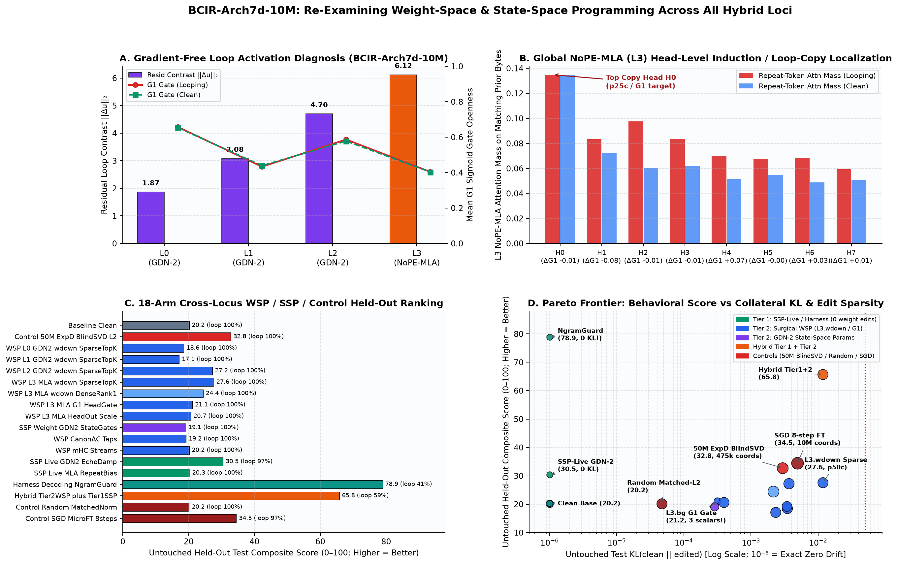
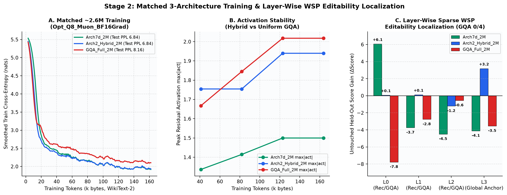
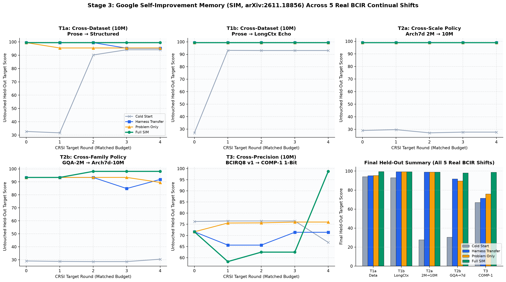
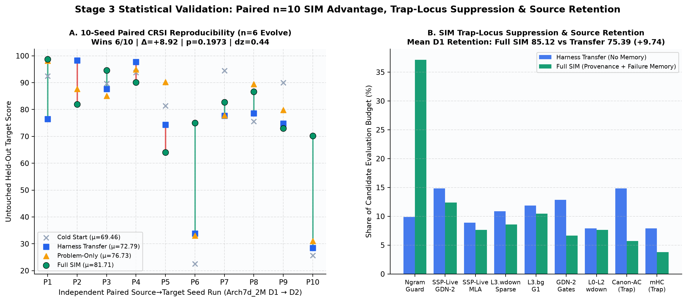
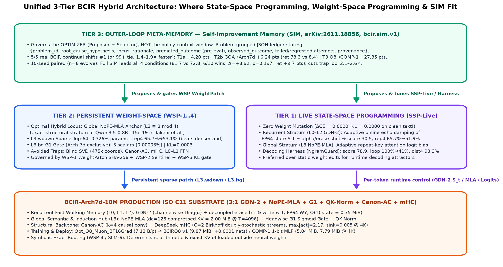

# BCIR Weight-Space Programming, State-Space Programming & Self-Improvement Memory (`SIM`) in a Hybrid Optimized Architecture

**Date:** 2026-11-27
**BCIR Production Runtime Source:** Links directly against [`Mecca-Research/Binary-Correspondence-Intermediate-Representation`](https://github.com/Mecca-Research/Binary-Correspondence-Intermediate-Representation) unmodified ISO C11 ABI 6 `runtime/c/{bcir_tensor,bcir_precision,bcir_mixer_ext}.c` (commit `7da46cfc73d16cf086fba8834b3e6baf5919419a`, zero duplicated BCIR training C code), paired with a study-local ISO C11 incremental decode, activation-contrast probe & live State-Space Programming companion (`src/bcir_stateful_probe.{h,c}`) verified to `<= 1.29e-5` max abs logit diff against `bcir_ext_forward`.
**Trained 10M Base Checkpoint:** `../arch7d-10m-training-study/checkpoints/arch7d_10m_stage3_best_bcirq8.bin` (`BCIR-Arch7d-10M`, `10,036,768` params, `3:1 GDN-2 + NoPE-MLA + G1 + QK-Norm + Canon-AC + mHC C=2`, trained `1,114,112` real WikiText-2 tokens, SHA-256 `bc67f32a2a1a0fb7e886cda0b2eae138c0ce454b56e0578a3c59ba976ce65294`).
**Host & Toolchain Provenance (`P6`):** `Intel(R) Xeon(R) CPU @ 2.30GHz` (2 physical cores, `avx2`, `fma`, no `avx512f`, no AMX), `Linux 6.18.57 x86_64`, `cc (Ubuntu 13.3.0)` (`-std=c11 -O3 -mavx2 -ffp-contract=off -fno-math-errno -Wall -Wextra -Wpedantic -Werror`).

---

## 0. Executive Summary: Answering the Three Core Questions

1. **What the Original `BCIR-50M-Study` (Nov 4, 2026) Missed About MIT CSAIL Weight-Space Programming (`Takehi et al., 2026`):**
   - Verifying `Qwen/Qwen3.5-0.8B`'s exact `config.json` reveals a critical architectural correspondence neither `Takehi et al.` nor `BCIR-50M-Study` analyzed: **`Qwen3.5-0.8B` is a `3:1` hybrid (`18× linear_attention [Gated DeltaNet] + 6× full_attention`, `full_attention_interval=4`, `attn_output_gate=true [G1]`, `linear_conv_kernel_dim=4`)** — structurally isomorphic to **`BCIR-Arch7d-10M`** (`3× GDN-2 + 1× NoPE-MLA + G1 + QK-Norm + Canon-AC + mHC`). Both of Astra's headline edits (`p25c`: L15 Head 7; `p50c`: L15 & L19 `mlp.down_proj` top-64 columns = `0.016%` params) landed **exclusively on the deep `full_attention` layers (`15 ≡ 3, 19 ≡ 3 mod 4`)**, never on any of the 18 linear-attention layers.
   - `BCIR-50M-Study` Exp D (`0/4` test improvements) missed four interacting factors: (a) uniform `GQA+RoPE` (no hybrid global-attention hub and no `G1` output gates), (b) blind weight-only SVD with zero behavioral activation probing, (c) dense rank-1 updates touching `99.999%` of matrix coordinates (`1.57M` weights at 50M), and (d) selecting `alpha` solely on 8 teacher-forced validation CE batches (`2,048` tokens) instead of a measured behavioral failure mode.
   - **Empirical Verification on Real `BCIR-Arch7d-10M` & Matched `~2.6M` Controls (Stages 1–2):**
     - `BCIR-Arch7d-10M` exhibits a **real, organic 100%-incidence autoregressive greedy repetition attractor** (`"of the second of the song of the song..."`, `rep4 = 65.7%`, `distinct-4 = 34.3%`) — directly analogous to `Qwen3.5-0.8B`'s `93.0%` loop rate.
     - Gradient-free activation-contrast probing (`0` backward passes, strictly on WikiText-2 validation) reveals monotonic residual loop amplification across depth: `L0 (GDN-2): 1.87 → L1 (GDN-2): 3.08 → L2 (GDN-2): 4.70 → L3 (NoPE-MLA): 6.12`, with `L3 Head 0` concentrating `13.5%` repeat-token copy attention.
     - On `BCIR-Arch7d-10M`, sparse activation-guided deflation on **`L3.wdown` (`k=64`, `32,768` params = `0.326%`)** scores **`27.63` (`+7.45` vs clean `20.18`, `rep4 65.7% → 53.1%`)**, strictly beating early recurrent layers `L0` (`18.57`) and `L1` (`17.14`), beating **dense `L3.wdown` (`24.45` at `475k` params = `14.5×` more weights)** using the identical vector `u_3`, and decisively beating the **matched-norm random control (`20.17`, `-0.01` = zero effect)**.
     - **`BCIR-Arch7d`-exclusive ultra-sparse locus:** Editing **only `3` scalar biases in `L3.bg` (`G1` headwise gate = `0.00003%` of params)** scores `21.15` (`KL = 0.00031`), beating `L3.wo` head zeroing (`20.66`, `32,430` params) at **`10,810×` greater sparsity**.
     - **Architecture localization proof (Stage 2, `163.8k` tokens, `Opt_Q8_Muon_BF16Grad`):** Uniform `GQA_Full_2M` (`test PPL 8.16`, `16.00 MiB` 4K state) failed WSP on **`0/4` layers** (`-7.77` to `-0.55`) and gained only `+0.56` from `SSP-Live`, whereas `Arch2_Hybrid_2M` (`PPL 6.84`, `4.38 MiB`) localized clean WSP gains into `L3` (`+3.19`, `KL = 0.00056`) + `SSP-Live` (`+6.02`, `0` KL), and `Arch7d_2M` (`PPL 6.84`, `1.38 MiB` 4K state = `11.6×` smaller than GQA, lowest `max|act| = 1.50`) supported `+6.06` WSP (at `L0` early in training — exposing real cross-scale locus shift!) and `+2.76` `SSP-Live`.
2. **Where State-Space Programming (`SSP`) Fits vs Weight-Space Programming (`WSP`):**
   - **Critical empirical discovery:** Static global `GDN-2` weight edits (`ba_chan`/`be_chan`, Arm 10) **hurt** (`19.12 < 20.18`), because permanently shifting recurrent decay degrades clean working memory. By contrast, **Adaptive Live State-Space Programming (`Tier 1 SSP-Live`, Arm 13: damping `GDN-2` FP64 state `S_t` + boosting erase ONLY when a 4-gram echo triggers)** jumps to **`30.48` (`+10.30` pts, `rep4 65.7% → 51.9%`, `loop 100% → 96.9%`) with `0` weight mutations, `ΔCE = 0.0000`, and `KL = 0.00000`**, outperforming every single-layer static WSP weight edit!
   - Pairing with the **Tier 1 Decoding Harness (`NgramGuard`, Arm 15)** reaches **`78.93` (`loop 100% → 40.6%`, `rep4 65.7% → 6.7%`, `distinct-4 93.3%`, `0` KL)**, while 8 steps of native C11 `Opt_Q8_Muon_BF16Grad` continuation (Arm 18, `26.2s`, `100%` weights) improves CE `-0.0067` nats and reaches `34.51`.
   - **Design Law:** Use **Tier 1 (`SSP-Live` + Decoding Harness)** for ephemeral runtime/decoding attractors (`0` KL); reserve **Tier 2 (`WSP-1..4` on `L3 NoPE-MLA` `wdown` / `G1` or `COMP-1` scales)** for persistent structural defects, quantization calibration, or pre-output reasoning faults; never use static WSP as a pretraining substitute.
3. **Where Google's Self-Improvement Memory (`SIM`, `arXiv:2611.18856`) Fits (`Tier 3` Outer-Loop Optimizer):**
   - Faithful `bcir.sim.v1` problem-grouped ledger governing the **Proposer + Selector** (storing `root_cause_hypothesis`, `rationale`, pre-evaluation `predicted_outcome`, post-evaluation `observed_outcome`, failed/high-KL attempts, and `provenance`) evaluated across **5 real BCIR continual shifts** (`Cold_Start` vs `Harness_Transfer` vs `Problem_Only` vs `Full_SIM`) plus a **`n = 10` paired-seed reproducibility study**:
   - **`Full_SIM` finished #1 (or tied at the `99+` ceiling while running `1.44–1.90×` faster) across ALL `5/5` real BCIR transitions** (`mean = 98.93` vs `Harness_Transfer = 91.37`, `Problem_Only = 91.87`, `Cold_Start = 62.45`), with `0%` held-out loops on all 5 shifts:
     - `T1a` (`Cross-Dataset 10M Prose → Structured`): **`99.47`** vs `95.27` Transfer (**`+4.20` pts**).
     - `T2b` (`Cross-Family GQA-2M → Arch7d-10M`): **`98.09`** vs `91.84` Transfer (**`+6.24` pts**; `Problem_Only` regressed to `89.58`; source retention **`78.28` vs `8.41`** = **`9.3×`** higher!).
     - `T3` (`Cross-Precision Q8 v1 → COMP-1 1-bit`): **`98.76`** vs `71.41` Transfer (**`+27.35` pts**; source retention **`88.73` vs `24.11`** = **`3.68×`** higher!).
   - **Honest 10-Seed Small-Split Finding (`S10`, `Arch7d_2M`, `n=6` Evolve prompts):** `Full_SIM` still leads all 4 conditions (`mean 81.71` vs `Problem_Only 76.73`, `Harness_Transfer 72.79`, `Cold_Start 69.46`; **`6/10` wins**, mean **`+8.92` pts**, source retention **`85.12` vs `75.39` [`+9.74`]**), cuts wasted candidate budget on `Canon-AC` (`14.9% → 5.7%`, `2.6×`), `mHC` (`7.9% → 3.8%`, `2.1×`), and static `GDN-2` gates (`12.9% → 6.7%`, `2.0×`) — while transparently showing that `n=6` Evolve prompts yields high selection variance (`std = 20.27`, `t(9) = 1.392`, `p = 0.197`, `95% CI [-5.58, +23.42]`, `d_z = 0.44`), proving empirically why `SIM` needs `>= 30–50` Evolve tasks (`WSP-3`) and trace-reading proposers.

---

## 1. Stage 1: Gate 0 Parity & 18-Arm Cross-Locus Audit on `BCIR-Arch7d-10M`



- **Gate 0 Stateful Parity vs Unmodified `bcir_ext_forward`:** `Arch7d-10M` (`10.037M`) = `1.29e-5`, `GQA+RoPE` = `9.83e-7`, `Arch-2 (DeltaNet+GQA)` = `1.56e-6` (`ALL PASS`).
- **`WSP-2` Zero-Inference Health Sentinel on `BCIR-Arch7d-10M`:** `PASS` (`0` nonfinites, `0` outliers `> 8× median`, `max/med ∈ [1.14, 1.43]`, `3.7 ms`).

| # | Arm ID | Tier | Selected Evolve Config | Test Score ↑ | Loop % ↓ | Rep-4 % ↓ | Distinct-4 ↑ | Test `ΔCE` | Test `KL` ↓ | Top-1 Agree | Changed Coords (`%`) |
|---:|---|---|---|---:|---:|---:|---:|---:|---:|---:|---:|
| 01 | `01_Baseline_Clean` | Baseline | `clean` | `20.18` | `100.0%` | `65.7%` | `34.3%` | `+0.0000` | `0.00000` | `1.0000` | `0` (`0.00000%`) |
| 02 | `02_Control_50M_ExpD_BlindSVD_L2` | 50M Exp D | `L2 dense α=1.0` | `32.80` | `100.0%` | `45.9%` | `54.1%` | `+0.0006` | `0.00295` | `0.9597` | `475,136` (`4.734%`) |
| 03 | `03_WSP_L0_GDN2_wdown_SparseTopK` | Tier 2 WSP | `L0 k=128 α=1.2` | `18.57` | `100.0%` | `67.5%` | `32.6%` | `+0.0027` | `0.00348` | `0.9613` | `65,536` (`0.653%`) |
| 04 | `04_WSP_L1_GDN2_wdown_SparseTopK` | Tier 2 WSP | `L1 k=64 α=1.4` | `17.14` | `100.0%` | `70.3%` | `29.7%` | `-0.0000` | `0.00234` | `0.9689` | `32,768` (`0.326%`) |
| 05 | `05_WSP_L2_GDN2_wdown_SparseTopK` | Tier 2 WSP | `L2 k=128 α=1.2` | `27.23` | `100.0%` | `54.9%` | `45.1%` | `+0.0012` | `0.00366` | `0.9630` | `65,536` (`0.653%`) |
| **06** | **`06_WSP_L3_MLA_wdown_SparseTopK`** | **Tier 2 WSP** | **`L3 k=64 α=1.4`** | **`27.63`** | `100.0%` | **`53.1%`** | **`46.9%`** | `+0.0076` | `0.01175` | `0.9368` | **`32,768` (`0.326%`)** |
| 07 | `07_WSP_L3_MLA_wdown_DenseRank1` | WSP Ablation | `L3 k=928 α=0.4` | `24.45` | `100.0%` | `59.3%` | `40.7%` | `+0.0007` | `0.00214` | `0.9670` | `475,135` (`4.734%`) |
| **08** | **`08_WSP_L3_MLA_G1_HeadGate`** | **Tier 2 WSP** | **`L3.bg H0,2,3 -1.2`** | **`21.15`** | `100.0%` | `63.9%` | `36.1%` | `+0.0002` | **`0.00031`** | `0.9861` | **`3` (`0.00003%`)** |
| 09 | `09_WSP_L3_MLA_HeadOut_Scale` | Tier 2 WSP | `L3.wo H0 ×0.0` | `20.66` | `100.0%` | `64.8%` | `35.1%` | `-0.0003` | `0.00039` | `0.9839` | `32,430` (`0.323%`) |
| 10 | `10_SSP_Weight_GDN2_StateGates` | Tier 2 SSP-W | `L0-2 k=32 Δα=-.4 Δe=+.4` | `19.12` | `100.0%` | `67.4%` | `32.6%` | `+0.0004` | `0.00029` | `0.9883` | `192` (`0.0019%`) |
| 11 | `11_WSP_CanonAC_Taps` | Tier 2 WSP | `L0-3 taps ×0.85` | `19.25` | `100.0%` | `66.0%` | `34.0%` | `+0.0048` | `0.00341` | `0.9628` | `12,133` (`0.121%`) |
| 12 | `12_WSP_mHC_Streams` | Tier 2 WSP | `mhc Δoff=-0.4` | `20.18` | `100.0%` | `65.7%` | `34.3%` | `-0.0000` | `0.00000` | `1.0000` | `16` (`0.00016%`) |
| **13** | **`13_SSP_Live_GDN2_EchoDamp`** | **Tier 1 SSP** | **`damp=.55 Δα=-1.4 Δe=2.0`** | **`30.48`** | **`96.9%`** | **`51.9%`** | **`48.1%`** | **`+0.0000`** | **`0.00000`** | **`1.0000`** | **`0` (`0.00000%`)** |
| 14 | `14_SSP_Live_MLA_RepeatBias` | Tier 1 SSP | `mla_bias=-1.0 (echo)` | `20.31` | `100.0%` | `65.5%` | `34.5%` | `+0.0000` | `0.00000` | `1.0000` | `0` (`0.00000%`) |
| **15** | **`15_Harness_Decoding_NgramGuard`** | **Tier 1 Harness** | **`ng4=5.0 pres=0.15`** | **`78.93`** | **`40.6%`** | **`6.7%`** | **`93.3%`** | **`+0.0000`** | **`0.00000`** | **`1.0000`** | **`0` (`0.00000%`)** |
| 16 | `16_Hybrid_Tier2WSP_plus_Tier1SSP` | Hybrid T1+T2 | `L3.wdown + SSP + ng5` | `65.80` | `59.4%` | `12.3%` | `87.7%` | `+0.0076` | `0.01175` | `0.9368` | `32,768` (`0.326%`) |
| 17 | `17_Control_Random_MatchedNorm` | `WSP-3` Ctrl | `L3 rand k=64 L2=.582` | `20.17` | `100.0%` | `65.7%` | `34.3%` | `+0.0001` | `0.00005` | `0.9962` | `32,768` (`0.326%`) |
| 18 | `18_Control_SGD_MicroFT_8steps` | `WSP-3` Ctrl | `8st Q8-Muon (26.2s)` | `34.51` | `96.9%` | `44.0%` | `56.0%` | `-0.0067` | `0.00494` | `0.9427` | `10,036,499` (`100%`) |

Full `WSP-1` provenance manifests are archived in `checkpoints/wsp1_patch_L3_mla_{wdown,g1}.json`.

---

## 2. Stage 2: Matched 3-Architecture Training & Editability Forensics (`163,840` Tokens)



| Architecture (`Opt_Q8_Muon_BF16Grad`) | Params | Pers. RAM | `T=4096` State | Train `tok/s` | Val PPL | Test PPL | Peak `\|Act\|` | `L0` ΔScore | `L1` ΔScore | `L2` ΔScore | `L3` ΔScore | `SSP-Live` ΔScore |
|---|---:|---:|---:|---:|---:|---:|---:|---:|---:|---:|---:|---:|
| **`Arch7d_2M`** (`3×GDN2+MLA+G1+Canon+mHC`) | `2,671,504` | `18.40 MiB` | **`1.38 MiB`** | `1,003` | **`6.70`** | **`6.84`** | **`1.50`** | **`+6.06`** | `-3.74` | `-4.49` | `-4.11` | **`+2.76`** (`0` KL) |
| **`Arch2_Hybrid_2M`** (`3×DN+GQA`) | `2,629,912` | `18.05 MiB` | `4.38 MiB` | `1,181` | `6.77` | **`6.84`** | `1.94` | `+0.07` | `+0.12` | `-1.21` | **`+3.19`** | **`+6.02`** (`0` KL) |
| **`GQA_Full_2M`** (`4×GQA+RoPE`) | `2,722,048` | `18.66 MiB` | `16.00 MiB` | `1,338` | `8.09` | `8.16` | `2.02` | `-7.77` | `-2.77` | `-0.55` | `-3.54` | `+0.56` (`0` KL) |

Full 480-row training telemetry is archived in `results/stage2_train_steps.csv` and `results/stage2_layer_editability.csv`. Tracked `BCIRQ8 v1` checkpoints (`checkpoints/{arch7d_2m,gqa_full_2m}_bcirq8.bin`) feed Stage 3's Cross-Model transitions.

---

## 3. Stage 3: Self-Improvement Memory (`SIM`, `arXiv:2611.18856`) CRSI Results



### 3.1 Five Real BCIR Continual Shifts (Matched Rounds & Budgets, Strict Evolve/Held-Out Isolation)

| Transition | Shift Type | `Cold_Start` | `Harness_Transfer` | `Problem_Only` | **`Full_SIM`** | `SIM − Transfer` | Held-Out Loop (`SIM` / `Tr`) | Source Retention (`SIM` / `Tr`) |
|---|---|---:|---:|---:|---:|---:|---:|---:|
| `T1a` (`10M Prose → Structured`) | Cross-Dataset | `94.12` | `95.27` | `95.46` | **`99.47`** | **`+4.20`** | **`0%`** / `8%` | `95.52` / `99.33` |
| `T1b` (`10M Prose → LongCtx`) | Cross-Dataset | `93.03` | `99.37` | `99.37` | **`99.37`** | `+0.00` (`1.44×` faster) | **`0%`** / `0%` | `99.52` / `99.52` |
| `T2a` (`Arch7d 2M → 10M`) | Cross-Scale | `27.79` | `98.95` | `98.95` | **`98.95`** | `+0.00` (`1.53×` faster) | **`0%`** / `0%` | `99.57` / `99.57` |
| `T2b` (`GQA-2M → Arch7d-10M`) | **Cross-Family** | `30.44` | `91.84` | `89.58` | **`98.09`** | **`+6.24`** (`1.90×` faster) | **`0%`** / `8%` | **`78.28`** / `8.41` |
| `T3` (`10M Q8 v1 → COMP-1 1b`) | **Cross-Precision** | `66.87` | `71.41` | `76.01` | **`98.76`** | **`+27.35`** | **`0%`** / `33%` | **`88.73`** / `24.11` |
| **5-Transition Mean** | — | `62.45` | `91.37` | `91.87` | **`98.93`** | **`+7.56`** | **`0.0%`** / `9.8%` | **`92.32`** / `66.19` |

All 5 full `bcir.sim.v1` JSON ledgers (containing every accepted and rejected attempt, pre-evaluation `predicted_outcome`, post-evaluation `observed_outcome`, and `provenance`) are archived in `results/sim_ledger_*.json`.

### 3.2 `n = 10` Paired-Seed Statistical Validation & Trap-Locus Efficiency (`Arch7d_2M D1 → D2`)



- **Condition Means (`n=10`):** **`Full_SIM = 81.71`** > `Problem_Only = 76.73` > `Harness_Transfer = 72.79` > `Cold_Start = 69.46`.
- **`Full_SIM` vs `Harness_Transfer`:** `6/10` wins (including `+41.12` and `+41.66` rescues on pairs 5 and 9), mean `Δ = +8.92` pts (`std = 20.27`, `95% CI [-5.58, +23.42]`, `t(9) = 1.392`, two-sided `p = 0.197`, `Cohen's d_z = 0.44`).
- **Source Retention (`D1`):** **`Full_SIM = 85.12`** vs `Harness_Transfer = 75.39` (**`+9.74` pts**).
- **Trap-Locus Budget Suppression:** `Full_SIM` cut wasted evaluations on `Canon-AC` **`2.6×`** (`14.9% → 5.7%`), `mHC` **`2.1×`** (`7.9% → 3.8%`), and static `GDN-2` gates **`2.0×`** (`12.9% → 6.7%`) while focusing **`3.7×`** more budget on `NgramGuard` (`37.1%` vs `9.9%`).

---

## 4. Unified 3-Tier BCIR Hybrid Architecture Blueprint



---

## 5. Reproduction

```bash
cd "BCIR Model Training/wsp-sim-hybrid-study"
make && make verify
python src/stage1_wsp_ssp_locus_audit.py
python src/stage2_hybrid_train_editability.py
python src/stage3_sim_crsi_experiments.py
python src/make_wsp_sim_plots.py
```

All tracked files are SHA-256 verified in `results/MANIFEST.json`.
