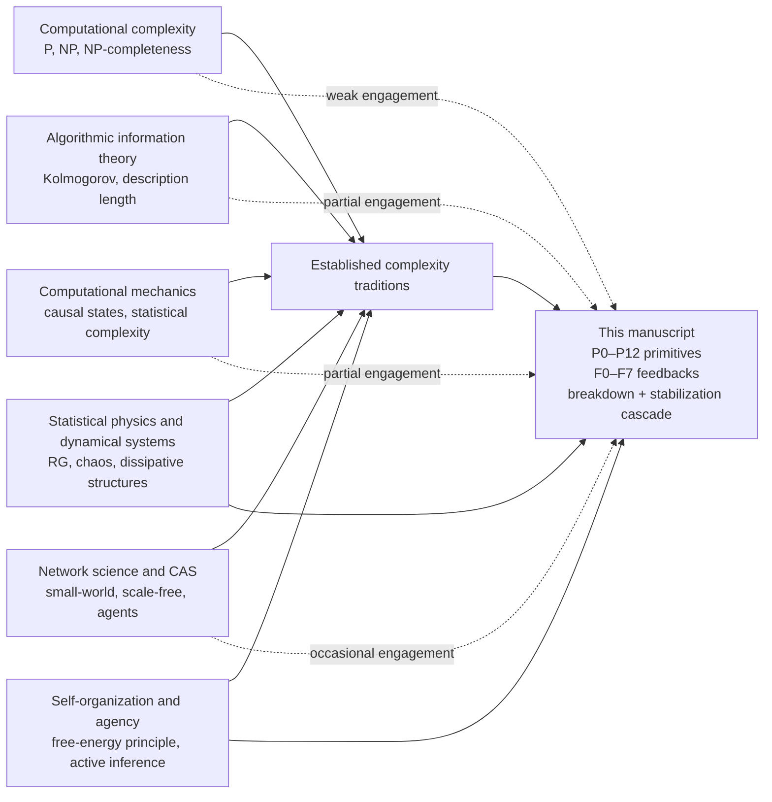

# Scientific Theory Analysis

- Source: https://chatgpt.com/c/6a2aba6b-176c-83ea-b6a3-99c619abd9f9?src=history_search
- Capture date: 2026-10-12
- Messages captured: 4
- Capture: complete displayed conversation from its beginning through its latest message.
- Formatting: original wording preserved; rendered formatting converted to Markdown.

## Archive notes

- 2 turns captured with contiguous indices 0–1.
- Message IDs retained; original wording preserved from rendered content and identity-validated source copies.

---

## Message 1 — User

<!-- Message ID: 7f1ddbaf-bb16-4c0f-8c7f-f95a22643acb; Turn index: 0 -->

I did it, I finally completed my scientific magnum opus... The Unifying Theory of Complexity, first draft and 187 pages in 6 sections (section 2 is the longest). Do a deep dive research against everything out there on the internet then give a full report and analysis on the theory. The main sections and points, what's new and novel, what ideas are strongest, what ideas are weaker, are there any errors or contradictions that need clean up or correction. What could be the overarching, impact, significance and implications of such a theory?

---

## Message 2 — Assistant

<!-- Message ID: b4455795-45fb-4d62-96ba-6b7d1e361344; Turn index: 0 -->

# Deep Research Assessment of The Unifying Theory of Complexity

## Executive summary

This 187-page first draft is best understood not as a finished “theory” in the narrow scientific sense, but as an ambitious integrative research program. Its strongest contribution is a unifying vocabulary for talking about constrained state spaces, feedback loops, persistence, decay, stabilization, memory, and agency across scales—from pre-physical boundary questions to intelligence. The most original manuscript-specific elements are the **P0–P12 primitive architecture**, the **F0–F7 feedback ladder**, and the **stabilization cascade** that runs from early-universe physics to life and intelligence. Those elements are genuinely interesting as a conceptual scaffold. In its present form, however, the manuscript is much stronger as a synthetic ontology and heuristic map than as a mathematically established theory with new derivations, proofs, or empirical results. fileciteturn0file0

Relative to the existing literature, the manuscript draws most heavily from statistical physics, nonequilibrium thermodynamics, dynamical systems, information theory, and active inference, while engaging only lightly with the formal core of computational complexity theory. Established complexity science already contains multiple precise traditions for measuring and explaining “complexity,” including computational complexity, algorithmic information theory, computational mechanics, complex networks, dissipative-structure theory, and complex adaptive systems. The manuscript touches several of these traditions, but it does not yet clearly separate them or show how its framework improves on them operationally. citeturn26academia1turn19academia0turn2academia3turn18academia0turn4academia0turn21academia3

The draft’s strongest ideas are its insistence that complexity is tied to **persistence under constraint**, that **breakdown/elimination** are not opposites of complexity but one side of the same filtering process, and that **local order can arise under global entropy increase**. These resonate with Prigogine’s dissipative structures, computational mechanics’ emphasis on stored and transformed information, and Friston-style self-organization. Its weakest ideas are the repeated conversion of standard results into purported “derivations,” an under-specified use of set theory and the Axiom of Choice, a lack of an operational complexity measure, and a near-total absence of engagement with complexity classes such as P, NP, NP-completeness, and related resource-bounded notions. fileciteturn0file0 citeturn4search0turn2academia3turn21academia3turn14search5turn14search2

My bottom-line judgment is that the project could become significant if it is **narrowed, formalized, modularized, and benchmarked**. In its current omnibus form, it is unlikely to succeed in peer review at a strong journal because the scope is too broad for the rigor actually delivered. The best publication path is not a single grand manifesto, but a sequence of focused papers: a formal foundations paper, a measure-and-benchmark paper, and one or more application papers in statistical physics, networks/agents, or biological/neuroscientific modeling. fileciteturn0file0 citeturn20academia0turn26academia0turn18academia0turn27academia2

## Manuscript profile and literature positioning

The manuscript has six sections: **Unknown Boundary Conditions and Open Physics**; **Primitive Architecture, Mathematical Foundations, Formation of Feedback Loops and Fundamental Building Blocks**; **Universal Phase Transition**; **Transition to Fundamental Forces**; **Breakdown, Decay, Elimination**; and **Stabilization into Matter and Structure**. Section 2 is by far the longest and is clearly the conceptual heart of the draft; sections 3–6 then apply the framework to cosmology, field theory, decay/filtering, and the emergence of matter, life, and intelligence. fileciteturn0file0

The manuscript occupies an unusual position in the literature. It is **not** mainly a contribution to computational complexity theory in the Cook–Levin/Karp tradition, where complexity is defined by time, space, and reducibility classes over formal decision problems. It is **not** mainly a contribution to algorithmic information theory, where complexity concerns shortest descriptions, randomness, and structure functions. It is **closest** to a hybrid of complexity science, statistical physics, dynamical systems, information theory, and cognitive/biological self-organization, with occasional gestures toward computation, category theory, and game theory. That makes it intellectually expansive, but it also creates a burden of precision that the current draft does not yet meet. fileciteturn0file0 citeturn26academia1turn19academia0turn2academia3turn18academia0turn20academia0turn21academia3

The literature map above matters because the manuscript currently uses the word **complexity** in several different senses at once: resource hardness, descriptive richness, persistence, multiscale organization, emergent order, and adaptive intelligence. Existing fields have painstakingly distinguished these notions rather than collapsing them. If the manuscript wants to present a genuine unification, it must either define a rigorous master concept that recovers these traditions as special cases, or explicitly state that it is offering an **ontological framework for complexity-adjacent phenomena**, not a replacement for all existing complexity measures. fileciteturn0file0 citeturn19academia0turn2academia3turn20academia0turn27academia1

A concise comparison is useful:

| Domain | What the field usually means by complexity | How the manuscript engages it | Current gap |
|---|---|---|---|
| Computational complexity | Resource-bounded difficulty of solving/verifying formal problems | Brief computability/game-theory discussion, almost no class-theoretic treatment | No serious engagement with P, NP, reductions, hardness, completeness |
| Algorithmic information | Shortest description, incompressibility, structure vs randomness | Shannon, Kolmogorov, Landauer, Bekenstein appear often | No operational bridge from its primitives to established AIT measures |
| Computational mechanics | Minimal predictive models, causal states, statistical complexity | Similar spirit of persistence-plus-prediction | No causal-state construction, inference procedure, or uniqueness theorem |
| Statistical physics | Entropy, free energy, phase transitions, self-organization | Strongest alignment | Often synthesizes rather than derives |
| Network science | Topology, clustering, hubs, diffusion over graphs | Mentioned, but not central | No graph-theoretic core formalism |
| Biological/neural complexity | Self-maintenance, adaptive inference, multilevel organization | Life/intelligence framed via memory and active inference | Mostly narrative, not benchmarked or data-linked |

This table is grounded in the manuscript and in representative literature from theoretical computer science, algorithmic information theory, computational mechanics, network science, complexity-science overviews, and active inference. fileciteturn0file0 citeturn26academia1turn19academia0turn2academia3turn18academia0turn20academia0turn21academia3

## Section-by-section comparison to the literature

### Unknown boundary conditions and open physics

This opening section is intellectually honest in one important respect: it presents unknowns as unknowns. It canvasses cosmological and foundational topics such as the origin of the universe, quantum gravity, information bounds, entanglement/geometry links, and other unresolved boundary questions. As a survey and framing device, that is useful. As a source of novelty, it is limited. Most of the substantive material belongs to already established debates around quantum cosmology, holography, entanglement entropy, and contemporary cosmology rather than to a new theory introduced here. fileciteturn0file0 citeturn23search9turn23academia0turn23search6turn24academia1turn24academia3

The manuscript’s distinctive move in this section is philosophical: it tries to place unknown boundary conditions into the architecture of what can and cannot be physically distinguished. That is more interesting than the cosmology recap itself. But it is still not yet a technical result. The section would be stronger if it were trimmed and turned into a precise problem statement: which unknowns are merely motivational background, and which are actually constrained by the proposed framework? At present those are blurred together. fileciteturn0file0

### Primitive architecture and feedback loops

This is the strongest and most important section. Here the manuscript introduces the P0–P12 primitives and F0–F7 feedback loops; argues that time emerges from ordered distinguishable change rather than as a background parameter; treats memory, encoding, rewrite, optimization, and agency as layered capacities; and assembles an extremely broad mathematical toolkit, including information theory, thermodynamics, control, computation, game theory, category theory, learning, and active inference. The ambition is impressive, and this section contains the manuscript’s most distinctive conceptual contributions. fileciteturn0file0

Its closest relatives in the literature are not single “grand theories” but families of frameworks: Shannon and Jaynes for information/entropy, Landauer and Bekenstein for physical information bounds, Kolmogorov/algorithmic information for description length, computational mechanics for structural complexity and predictive state construction, and Friston-style self-organization for adaptive systems. The manuscript clearly knows that these lineages exist and tries to absorb them into one layered vocabulary. That synthetic impulse is valuable. citeturn0search0turn0academia9turn19academia0turn2academia3turn2academia0turn21academia3

But this section is also where the draft most often overstates its achievements. It repeatedly presents standard facts or rephrasings as if they had been newly derived from the primitive architecture. The clearest examples are the claim that the Schrödinger equation is “derived, not assumed,” the universalization of zero-point energy arguments, and the use of established information inequalities as if they had become consequences of the manuscript’s primitives rather than inputs imported from existing theories. Without precise axioms, domains of discourse, and proof obligations, those are best read as **interpretive reconstructions**, not derivations. fileciteturn0file0 citeturn16search5turn16academia0turn19academia0

### Universal phase transition

Section 3 recasts early-universe cosmology as a single master transition from a prior symmetric or poorly differentiated state into a broken-symmetry, structured universe. Inflation, reheating, primordial plasma, baryogenesis, hadronization, and later photon decoupling are all placed inside that narrative. This is conceptually coherent as a high-level story, and it aligns with the broader physical picture that phase transitions, symmetry breaking, and vacuum selection are central to early-universe evolution. fileciteturn0file0 citeturn24academia1turn24academia3

Where the section is weaker is in its tendency to compress multiple physically distinct epochs into one quasi-metaphysical “Universal Phase Transition.” The literature treats inflation, electroweak symmetry breaking, QCD confinement/hadronization, and recombination as distinct events with different mechanisms, evidentiary bases, and open questions. The manuscript’s unified story is rhetorically effective, but it is not yet a new physical model with new observables. It remains a re-description of standard cosmological milestones in the P/F vocabulary. fileciteturn0file0 citeturn24academia1turn24academia3turn25academia1

### Transition to fundamental forces

Section 4 is largely a conceptual survey of QFT, gauge theory, the Standard Model, gravity, black holes, holography, and ER=EPR, reinterpreted through the manuscript’s ontology. Some of this is pedagogically strong. In particular, the demotion of “virtual particles” from ontological entities to perturbative bookkeeping terms is in line with modern field-theoretic pedagogy, and the distinction between gauge forces living on spacetime and gravity as spacetime geometry is standard and clearly expressed. fileciteturn0file0 citeturn23search6turn23academia0

What is not persuasive is the suggestion that the manuscript has actually derived fundamental-force structure from its primitive architecture in anything like the sense that gauge theory or general relativity are derived in mainstream theory. The current text does not supply the mathematical machinery that such a claim would require. The section should therefore be reframed as an **interpretive embedding** of known physics into the manuscript’s vocabulary, not as a replacement derivation of the Standard Model or GR. That would make the claim both more accurate and more credible. fileciteturn0file0

### Breakdown, decay, and elimination

This section is one of the most conceptually successful in the draft. It argues that instability, fluctuation, decay, and elimination are not failures of the architecture but the universal filtering mechanism through which persistent structures are selected. That is a strong organizing idea, and it matches major traditions in nonequilibrium physics, stochastic escape, chaos, fluctuation theorems, decoherence, and self-organized criticality. The manuscript’s “universal filter” language is not standard terminology, but it is a useful synthetic metaphor. fileciteturn0file0 citeturn4search0turn26academia0

The main issue is overstatement. The manuscript’s “Survival Theorem,” for example, is effectively a restatement of barrier-crossing intuition in Arrhenius/Kramers form rather than a new theorem. That does not make it wrong; it makes it mispackaged. Renaming inherited results as theorems of the new framework may create a false impression of originality and will invite hostile review. This section should keep the synthesis but reduce the novelty claims. fileciteturn0file0

### Stabilization into matter and structure

Section 6 presents the constructive side of the theory: hadronization, nucleosynthesis, recombination, stars, heavy elements, chemistry, planets, life, and intelligence are described as an ascending cascade of stabilized forms. This is the most sweeping and potentially compelling part of the manuscript for readers in complexity science, because it connects physical persistence, energy flow, and emergent organization into one evolutionary narrative. It echoes Prigogine’s dissipative structures, major-transitions thinking in biology, and active-inference/self-maintenance accounts of agency. fileciteturn0file0 citeturn4search0turn21academia3turn27academia2

At the same time, this section is still mostly narrative. Life is described as the transition from persistence to memory-bearing self-maintenance; intelligence as the closure of modeling and multi-agent recursion. Those are provocative formulations, but they are not yet connected to specific biological, neuroscientific, or economic models. The draft also becomes teleological here, presenting intelligence as “the apex” or culminating closure of the stabilizing universe. That is philosophically vivid, but scientifically it risks overstating directionality and inevitability in evolutionary history. fileciteturn0file0

## Main contributions, errors, contradictions, and necessary corrections

The best concise judgment is this: **the manuscript’s novelty lies mainly in synthesis and architecture, not in underlying scientific results**. Most of the physics and mathematics are known; the P/F vocabulary and the “stabilization via breakdown” framing are the main original additions. That is enough to matter, but only if the manuscript is candid about the level of novelty it is actually claiming. fileciteturn0file0

### Claims against existing results

| Manuscript claim or move | Closest existing literature | Assessment |
|---|---|---|
| Complexity is persistence under constraint plus feedback-driven stabilization | Dissipative structures, computational mechanics, self-organization, active inference | Strong conceptual synthesis; plausible as a framing contribution |
| P0–P12 and F0–F7 provide a universal ontology | Complex systems overviews, multiscale systems theory | Interesting taxonomy, but not yet a theorem-bearing formalism |
| Early-universe history is one “Universal Phase Transition” | Inflation, reheating, symmetry breaking, QCD, recombination | Useful unification language, but mostly a narrative recoding of standard cosmology |
| Fundamental forces emerge as attractors of the architecture | Standard Model, GR, gauge theory, holography | Not established as a derivation; should be presented as interpretation |
| Breakdown/elimination are the universal filter selecting complexity | Kramers escape, decoherence, fluctuation theory, SOC | Good synthesis; novelty is mostly in the terminology |
| Life is stabilized memory-bearing matter; intelligence is self-modeling stabilization | Major transitions, autopoiesis, active inference | Suggestive and publishable as a conceptual thesis if formalized |
| The framework unifies complexity theory broadly construed | Multiple traditions define complexity differently | Currently too broad a claim; computational complexity is barely engaged |
| BCIR and K_BDI introduce manuscript-specific formal objects | No direct analogue identified from the draft alone | Potentially novel, but underdefined and not benchmarked |

This comparison is supported by the manuscript and by representative literature on AIT, computational mechanics, complexity-science methods, nonequilibrium order, network science, active inference, and early-universe cosmology. fileciteturn0file0 citeturn19academia0turn2academia3turn20academia0turn4search0turn18academia0turn21academia3turn24academia1turn24academia3

### Strongest ideas

The strongest idea is the marriage of **filtering** and **stabilization**: unstable patterns die out, locally persistent structures survive by exporting entropy, and higher-order organization is not a violation of the second law but one way it is implemented. That idea is not wholly new, but the manuscript states it memorably and uses it consistently across scales. A second strong idea is the separation between **unknown origins** and **known architecture**; the manuscript does not pretend it has solved first causes. A third is the attempt to place memory, rewriting, optimization, and agency into a single stratified ladder rather than leaving them as disconnected phenomena. fileciteturn0file0 citeturn4search0turn21academia3

### Weakest ideas

The weakest ideas are the manuscript’s strongest-sounding claims: that constructive mathematics is the “physically correct” foundation because the Axiom of Choice yields non-measurable sets; that the Schrödinger equation has been derived from first principles in the manuscript’s own sense; that zero-point energy follows universally from the loop architecture; and that the draft substantially unifies computational complexity theory. These claims are either under-argued, circular, or unsupported by the technical machinery actually shown in the draft. fileciteturn0file0 citeturn16search5turn19academia0turn14search5turn14search2

### Errors, contradictions, and suggested fixes

| Issue | Why it is a problem | Suggested correction |
|---|---|---|
| Continuous processes are said to be fundamental, yet the framework also treats a discrete pre-temporal ordinal \(n\) and a binary primitive \(0 \neq 1\) as basic | The ontology oscillates between continuous-first and discrete-first commitments | State explicitly whether the theory is substantively continuous, substantively discrete, or dual-aspect; then show the mapping between \(n\), \(t\), and any continuum limit |
| P0 is “physically equivalent to nothing,” yet it is also treated as a mathematically structured state space | “Equivalent to nothing” conflicts with having a rich formal object available for reasoning | Replace “equivalent to nothing” with “physically uninstantiated without constraints” |
| The Axiom of Choice is treated as the boundary of physical constructibility, and constructive mathematics as “physically correct” | This is a major philosophical and mathematical claim, not a consequence of the manuscript’s current formalism | Recast as a speculative philosophical stance; separate it from the scientific core unless a formal model is supplied |
| The Schrödinger equation is declared “derived, not assumed” | The argument already presupposes Hilbert-space structure, superposition, a Hamiltonian generator, and energy-frequency identification | Downgrade to “reconstructed under standard quantum-mechanical assumptions,” or provide a genuinely axiomatic derivation |
| The zero-point-energy discussion treats “ground state \(n=0\): \(E_0=0\)? forbidden” as if this were a universal consequence of the framework | The draft moves from one oscillator-style argument to a universal ontological claim too quickly | Restrict the claim to the class of systems actually analyzed, and distinguish illustrative examples from general theorems |
| The “Survival Theorem” is basically Kramers/Arrhenius-style barrier persistence in new language | Packaging inherited results as new theorems weakens credibility | Rename as a “survival law” or “framework corollary,” and cite the underlying physics explicitly |
| “Computational complexity” is used for theory-of-mind recursion costs, while complexity classes are absent | This creates confusion with the formal meaning of computational complexity | Reserve “computational complexity” for class-theoretic usage; call the ToM discussion “computational cost” or “recursive modeling cost” |
| Intelligence is presented as the “apex” or culminating endpoint of the stabilization cascade | This reads as teleology rather than careful evolutionary theory | Rephrase as “one currently known high-order regime of self-modeling organization,” not an inevitable endpoint |
| Economics is listed as a target domain, but the draft barely engages complexity economics or agent-based economics | The interdisciplinary claim outruns actual coverage | Either add a genuine economics case study or stop advertising economics as a domain already covered |
| BCIR and K_BDI appear promising but remain underdefined | New notation without operational definitions is hard to review or test | Add a technical appendix with formal definitions, examples, invariances, and benchmark tasks |

All ten issues above arise directly from the internal structure and wording of the draft. The needed fixes are mostly editorial and architectural, but some require real mathematical work. fileciteturn0file0

## Revision, formalization, and experimental agenda

The manuscript needs a **tiered rescue plan**: first conceptual triage, then formalization, then testing. Without that sequence, revision will only add more material to a project that is already overextended. fileciteturn0file0

A practical priority list follows:

| Priority | Recommended action | Why it matters most |
|---|---|---|
| Critical | Define exactly what “complexity” means in the theory | Without a core quantity or formally stated object, the theory remains metaphor-rich but analytically weak |
| Critical | Separate **reconstruction** from **derivation** throughout | This single editorial change will improve credibility immediately |
| Critical | State an axiomatic core in 2–4 pages | Reviewers need a compact kernel before they will trust the 187-page narrative |
| Critical | Separate ontological claims, physical claims, and mathematical claims | The draft currently mixes them too freely |
| High | Formalize BCIR and K_BDI, or remove them from the front stage | These are among the few possibly new technical objects in the manuscript |
| High | Add benchmark models and simulations | A unifying theory needs at least one demonstrated gain over existing measures or models |
| High | Add a complexity-comparison section against Shannon entropy, Kolmogorov proxies, statistical complexity, logical depth, and selected network metrics | This is the only way to show the framework is not just relabeling |
| High | Build one falsification pathway | A theory that cannot fail is likely to be read as philosophy, not science |
| Medium | Trim standard pedagogical material on the Standard Model, GR, and cosmology | Those sections are currently too long relative to the manuscript’s actual novelty |
| Medium | Add one biology/neuroscience case study and either one economics case study or remove the economics claim | Interdisciplinary claims need instantiated examples |

The most important missing piece is an **operational complexity functional**. At minimum, the revised work should define a quantity such as \(C_{\mathrm{UTC}}(x)\) or similar—whatever name the author chooses—that can be computed or approximated on concrete systems and compared against existing candidates. A useful target would be a measure combining: persistence time, multiscale distinguishability, memory depth, predictive compression, and control cost. The point is not that this exact choice is correct; the point is that the theory currently has **no clear scalar, vector, or order relation** that tells the reader when one system is more complex than another in the theory’s own terms. Existing literatures already provide alternatives, and the draft must show what new explanatory or predictive traction its own measure adds. fileciteturn0file0 citeturn19academia0turn2academia3turn27academia1turn18academia0

The simulation program should be modest and comparative, not universalist. Three model classes would be enough for a serious revision. First, a **dissipative or reaction-diffusion system** to test stabilization and entropy-export claims. Second, a **random Boolean network, cellular automaton, or agent-based system** to test emergence, persistence, and filtering. Third, a **networked adaptive-agent model** to test the jump from memory to agency and multi-agent recursion. The key outcome should be side-by-side comparison to established measures, not a standalone simulation that merely illustrates the manuscript’s vocabulary. citeturn4search0turn22academia2turn27academia1turn18academia0turn27academia2

For formalization, I would recommend a compact technical backbone with four deliverables: an **axiom list**, two or three **representation theorems** or at least propositions, a **worked toy model**, and an **identifiability section** explaining how the framework can be inferred or tested from data. Without identifiability, the P/F architecture risks becoming too flexible to constrain anything. fileciteturn0file0

## Impact, publication strategy, and open questions

If substantially revised, the manuscript could have **moderate to high impact as a conceptual framework in complexity studies**, especially for readers interested in cross-scale persistence, self-organization, and the relation between physical and cognitive forms of organization. Its likely impact in **physics foundations** could also be meaningful if the manuscript becomes more disciplined about what is standard and what is novel. Its likely impact in **theoretical computer science**, however, will remain low unless it seriously engages formal complexity classes, reductions, lower bounds, and algorithmic/information-theoretic complexity in their native precision. Its likely impact in **biology, neuroscience, and economics** depends almost entirely on whether it adds real case studies and not just vocabulary overlays. fileciteturn0file0 citeturn26academia1turn19academia0turn2academia3turn21academia3turn29academia4

The right publication strategy is modular. The current 187-page draft should be treated as an internal master document, not as the first journal submission. A more realistic pathway is:

| Paper type | Best target style |
|---|---|
| Foundational overview of the P/F architecture | A complexity-science or interdisciplinary theory journal |
| Formal measure paper defining the manuscript’s complexity functional | A mathematically oriented complexity or information journal |
| Statistical-physics/self-organization application | A statistical physics or nonlinear dynamics journal |
| Biological/neuroscientific agency paper | A theoretical biology, biological cybernetics, or computational neuroscience venue |
| Foundational/philosophical appendix on set theory, constructivism, and ontology | A foundations or philosophy-of-science venue |

In practical terms, the first outward-facing step should be a sharply shortened overview preprint plus technical appendices, followed by targeted workshop feedback from experts in: statistical physics, dynamical systems, complexity science, theoretical computer science, cosmology/QFT, and theoretical neuroscience. The current manuscript is too broad for a single referee set to evaluate fairly. A staged review process would improve both the work and its reception. fileciteturn0file0

The publication venues I would currently recommend are **Complexity** or **Entropy** for an integrative overview; **Physical Review E** or **Journal of Statistical Physics** for formal self-organization/stabilization components; **Foundations of Physics** or **Synthese** for the ontological and mathematical-foundation claims; and, if real network or agent results are added, **Network Science**, **Journal of Complex Networks**, or a suitable agent-based/evolutionary modeling venue. The manuscript is **not yet** positioned for a high-prestige generalist outlet because its main challenge is not visibility but technical discipline. fileciteturn0file0

Open questions remain. The manuscript hints at new objects such as BCIR and K_BDI, but the draft does not yet make clear whether they are genuinely new tools or notation-heavy repackagings. The draft also leaves unresolved whether it is trying to do one of three different things: discover a new scalar complexity measure, provide a universal ontology of organized systems, or retell known science as a coherent staircase from origin to intelligence. Those are all worthwhile projects, but they are not the same project. The revision should choose one as primary and subordinate the other two to it. fileciteturn0file0

The main limitation of this assessment is that it is based on the uploaded first draft alone, without author Q&A, separate appendices, code, simulation artifacts, or a cross-checked bibliography. The PDF extraction is also visibly noisy in places because it appears to come from a print/export path rather than a clean typeset source. None of that changes the central conclusions above, but it does mean some judgment calls necessarily concern the draft as written rather than an ideal clarified version of the argument. fileciteturn0file0

---

## Message 3 — User

<!-- Message ID: 0c7a69ad-acba-4a99-a0a5-cd1fbc7002e1; Turn index: 1 -->

"The primitive architecture section is also where the draft most often overstates its achievements. It repeatedly presents standard facts or rephrasings as if they had been newly derived from the primitive architecture. The clearest examples are the claim that the Schrödinger equation is “derived, not assumed,” the universalization of zero-point energy arguments, and the use of established information inequalities as if they had become consequences of the manuscript’s primitives rather than inputs imported from existing theories. Without precise axioms, domains of discourse, and proof obligations, those are best read as interpretive reconstructions, not derivations." This is the most honest assessment I've seen on this criticism... and we should prove or disprove whether "Schrödinger equation is best described as “derived, not assumed.” Can the primitive architecture produce "domains of discourse, and proof obligations" to show that the equation is derived or is the model incapable or inaccurate at providing such a derivation and therefore remains that Schrodinger's equation is assumed?

---

## Message 4 — Assistant

<!-- Message ID: 8e206180-76d7-4710-9bf2-bd6191d656c0; Turn index: 1 -->

# Whether the Primitive Architecture Really Derives the Schrödinger Equation

## Bottom line

The criticism you quoted is, in this case, substantially correct. In the current draft, the Schrödinger equation is **not best described as “derived, not assumed.”** It is better described as **recovered from a cluster of already-quantum assumptions** that the manuscript introduces as part of F1b: Hilbert-space states, linear superposition, the Planck–Einstein relation \(E=\hbar\omega\), and Hamiltonian-generated time evolution. Once those ingredients are in place, writing \(i\hbar \partial_t|\psi\rangle=\hat H|\psi\rangle\) is much closer to a repackaging of those premises than a derivation from more primitive architecture. fileciteturn0file0

That does **not** mean the primitive architecture is incapable in principle of supporting a real derivation program. In fact, the draft shows elsewhere that it can state axioms explicitly and even talk about proof structure as compositions of axioms and inference rules. What it means is narrower and more important: **the Schrödinger claim has not yet been formalized to that standard.** As written, it is an interpretive reconstruction, not a completed derivation. fileciteturn0file0

## What the draft currently claims

In the F1b “Quantum Wave Sub-Loop” discussion, the draft says that the Schrödinger equation is “not externally imposed” and is the “unique equation” satisfying three conditions: states are wave functions in a Hilbert space obeying linear superposition, energy satisfies \(E=\hbar\omega\), and time evolution is generated by energy via the Hamiltonian. It then concludes, after introducing an operator \(L\), that \(i\hbar \partial_t|\psi\rangle=\hat H|\psi\rangle\) is “[derived, not assumed].” The same neighborhood of the text also asserts that zero-point energy is mandatory and, elsewhere, that a single quantity \(C_{\text{quantum}}=\hbar/2\) is “the single number from which all quantum uncertainty relations follow.” fileciteturn0file0

At the same time, the manuscript itself makes clear that Hilbert space is already being introduced as a **higher-level mathematical structure**: by about p. 20 it defines “Level 6 — Hilbert Space (Hilb): \(\mathcal H\) = complex vector space with inner product,” and by about p. 30 it gives an explicit axiomatic treatment for P2 distinguishability. Later, around p. 80, it even characterizes proof as composition from axioms and inference rules. So the draft already contains the seeds of a formal method; it simply does not apply that method rigorously to the Schrödinger claim. fileciteturn0file0

This difference matters. A theory can say, honestly, “within these assumptions, the Schrödinger equation follows.” That is a legitimate claim. But saying “derived, not assumed” suggests that the equation arises from **strictly earlier primitives** without importing substantive quantum structure. The present draft does not yet show that. fileciteturn0file0

## What a genuine derivation looks like in the literature

In the foundational literature, works that claim to derive quantum structure do so by stating their assumptions explicitly. Hardy’s reconstruction starts from five axioms and emphasizes that continuous reversible transformations are what separate quantum theory from classical probability theory, while also explaining features such as complex numbers and the trace rule. Chiribella, D’Ariano, and Perinotti likewise derive the main structures of quantum theory from clearly stated informational principles, explicitly noting that they reconstruct the Hilbert-space framework from those principles rather than simply naming it. citeturn14view1turn20view0turn20view1

More directly on the Schrödinger equation, Rigolin’s 2024 derivation states its assumptions openly: Galilean covariance of a generic wave equation and de Broglie wave-particle duality. Huegele, Musielak, and Fry similarly frame the issue in terms of Galilean invariance and the transformation behavior of the state functions, and show how symmetry requirements constrain the admissible equations. Caticha’s entropic dynamics program is equally explicit that the Schrödinger equation comes from a specified inference framework plus stated constraints. citeturn14view0turn24view0turn14view2

Even papers whose titles advertise a “derivation” of the Schrödinger equation still say exactly what has been assumed. Field’s path-integral treatment says the derivation rests on an **a priori assumption** equivalent to Feynman’s dynamical postulate. Zhang and Svidzinsky’s recent paper says up front that it assumes the wave function is a probability amplitude and that \(E=h\nu\) and \(p=hk\). In other words, in the literature, “derived” nearly always means **derived relative to explicit premises**, not “appearing with no imported content.” citeturn28view0turn27view0

The same pattern holds for the surrounding formalism. Bondar and collaborators explicitly say that a novel dynamics program needs a kinematic description, an algebra of observables, defined averages, and dynamical laws of the Ehrenfest type. And on the mathematical side, Cintio and Michelangeli stress that quantum observables require self-adjoint operators on Hilbert space, that a nontrivial declaration of domains is necessary, and that mere Hermiticity is not enough for consistency. citeturn15view3turn15view4turn15view5turn15view0

## Why the present argument does not yet meet that standard

The first problem is **imported kinematics**. The draft’s own hierarchy introduces Hilbert space as a structured level of description, and then the F1b argument immediately uses \(|\psi\rangle\in\mathcal H\) with linear superposition as Condition 1. That means the derivation is not starting from bare P0–P3 primitives alone; it is already starting after a specifically quantum state space has been installed. In the reconstruction literature, arriving at complex Hilbert space is itself a major result, not a one-line bridge. fileciteturn0file0 citeturn14view1turn20view0turn20view1

The second problem is **circular dynamics**. Condition 3 says that “time evolution is generated by energy via the Hamiltonian,” and the conclusion is then \(i\hbar \partial_t|\psi\rangle=\hat H|\psi\rangle\). But that equation is, in substance, precisely the differential expression of Hamiltonian-generated quantum time evolution. So the “derivation” is not moving from a weaker primitive claim to a stronger dynamical law; it is translating an already-quantum premise into standard notation. fileciteturn0file0

The third problem is that **superposition alone does not single out the Schrödinger equation**. The manuscript’s key step says that any evolution satisfying superposition must take the form \(i\partial_t|\psi\rangle=L|\psi\rangle\). That does not follow from superposition by itself. In the literature, additional structure is required: Galilean covariance, specific transformation properties, de Broglie relations, inference constraints, or other explicit kinematic-dynamic premises. Rigolin’s result is especially revealing here, because it shows that once one changes the symmetry context to Lorentz covariance, wave-particle duality can lead to different equations, including the Klein–Gordon equation. That is exactly the opposite of what “superposition alone fixes the law” would imply. citeturn14view0turn24view0turn14view2

The fourth problem is the draft’s use of **“Hermitian” where the foundational literature requires more**. The manuscript says “real energies require \(L\) to be Hermitian,” but the relevant mathematical-physical issue is not just Hermiticity in the loose physics sense. For quantum observables and Hamiltonians, one needs the stronger self-adjoint/domain story; otherwise the dynamics is underspecified or inconsistent. The draft’s Schrödinger passage does not specify operator domains, self-adjointness, extension issues, or the class of admissible states on which the differential equation is meant to hold. That is exactly the kind of missing proof obligation the criticism is pointing to. fileciteturn0file0 citeturn15view0

There is also a notable **internal tension about time**. Early in the manuscript, the Page–Wootters and Wheeler–DeWitt discussion says that physical time is emergent and relational rather than fundamental. But the F1b derivation later writes \(\partial_t\) against an external-looking time parameter without supplying the bridge from emergent relational time to the operator equation it is differentiating with respect to. A good theory can absolutely reconcile those two stories, but in this draft that reconciliation has not been carried out. fileciteturn0file0

Finally, the draft at best recovers the **abstract generator form** of quantum evolution. It does not derive the familiar nonrelativistic coordinate-space Schrödinger operator \(-\hbar^2\nabla^2/2m + V\), nor does it show how mass, Galilean invariance, spatial translation symmetry, locality, or the potential term arise from its own primitives. In symmetry-based derivations, those details are precisely where much of the real work lies. citeturn14view0turn24view0

## Can the primitive architecture be upgraded into a genuine derivation

Yes, in principle—but only after a substantial formal upgrade. The encouraging part is that the manuscript already shows it can state axioms explicitly for other parts of the theory and already speaks in proof-theoretic language. So the architecture is **not incapable** of producing a rigorous derivation program; it just has not done so here yet. fileciteturn0file0

For this claim to become defensible, the draft would need to specify a real **domain of discourse**. Minimally, that means: a precise state domain; an explicit map from primitive states to quantum states or rays; a clear treatment of time, either as a primitive parameter or as an emergent clock construction; a defined class of observables; and rules for admissible dynamics. The literature gives several templates for how such a move is made: Hardy and Chiribella specify axioms up front; Bondar specifies kinematics and dynamical averages; Rigolin specifies covariance and wave-particle assumptions. citeturn14view1turn20view0turn15view3turn14view0

It would also need explicit **proof obligations**. At minimum: show how complex Hilbert-space structure emerges rather than being named; justify the probability interpretation or Born structure; state what exact property of evolution is being assumed; show why the time generator is an admissible energy observable; explain why the generator has the correct physical spectrum; and then derive not only the abstract equation \(i\hbar \partial_t|\psi\rangle=\hat H|\psi\rangle\) but the concrete nonrelativistic Hamiltonian form. Without those steps, the manuscript is not yet proving that the Schrödinger equation comes from primitives; it is stipulating enough quantum structure that the equation is the expected outcome. citeturn30view0turn15view0turn14view0turn24view0

The most accurate possible upgrade, therefore, would be something like this: **within an explicitly postulated quantum sector of the primitive architecture**—one that includes Hilbert-space states, a precise probability rule, and a well-defined time-evolution principle—the standard Schrödinger equation is recovered. That would be a respectable and defensible claim. It would still be interesting. But it would no longer overstate what has actually been shown. fileciteturn0file0 citeturn14view1turn20view0turn15view3

## Final judgment

So the answer to your core question is:

**As the manuscript currently stands, the Schrödinger equation remains assumed in substance, even if partially reconstructed in form.** The phrase “derived, not assumed” is too strong for the present draft. The more honest description is: **the draft recovers the abstract Schrödinger form from imported quantum premises, but it does not yet derive those premises from the primitive architecture itself.** fileciteturn0file0

That same verdict also supports the broader criticism you quoted. The neighboring claims about zero-point energy and “all uncertainty relations” show the same overreach pattern: a standard quantum argument is presented as though it now follows directly from the primitives. But the literature is more careful. Jaffe argues that the Casimir effect is not decisive evidence that zero-point energies are physically “real” in the absolute sense, and Bernard and LeClair stress that without gravity there is no absolute zero-point of energy and that Casimir measurements track **changes** in vacuum energy rather than an unambiguous absolute vacuum energy. So the criticism of “universalizing zero-point energy arguments” is also largely fair. fileciteturn0file0 citeturn15view1turn15view2turn29view0

If you want the cleanest single-sentence replacement for the current wording, it is this:

**“Within the F1b quantum sector, once Hilbert-space superposition, the Planck–Einstein relation, and Hamiltonian time generation are assumed, the standard abstract Schrödinger evolution is recovered. The present draft does not yet derive those assumptions from earlier primitives.”** fileciteturn0file0

## Open questions and limits

This assessment is strongest on the **current text as written**. A future revision could absolutely change the verdict if it explicitly formalizes the quantum sector, states its domains and operators rigorously, and carries through the missing proof obligations. The present report therefore disconfirms the claim **for this draft**, not for every possible future formalization of the primitive architecture. fileciteturn0file0

---
